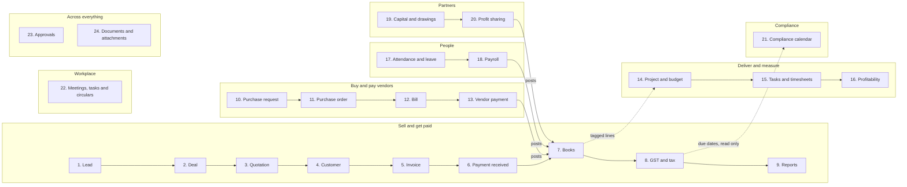

# Tera2Nano ERP: module guide

> Generated from `frontend/src/modules/guide/guideData.js` (and `guideModulesA.js`, `guideModulesB.js`, `rolesData.js`) by
> `frontend/scripts/build-guide-docs.mjs`. Do not edit this file by hand: change the data, then run `node scripts/build-guide-docs.mjs` in `frontend/`.
> The in-app Guide (the Guide tile on the launcher, `/guide`) shows exactly the same content.

## Contents

1. [What this system is](#what-this-system-is)
2. [The process from end to end](#the-process-from-end-to-end)
3. [How the modules connect](#how-the-modules-connect)
4. Module guides: [CRM](#crm), [Sales](#sales), [Purchases](#purchases), [Accounting](#accounting), [GST & Tax](#gst--tax), [Projects](#projects), [People (HR)](#people-hr), [Partners](#partners), [Approvals](#approvals), [Compliance](#compliance), [Workplace](#workplace), [Reports](#reports), [Documents](#documents), [Company](#company), [Administration](#administration)
5. [Roles and access](#roles-and-access)
6. [Glossary](#glossary)

## What this system is

The Tera2Nano ERP runs the business of one Indian LLP in one place: winning customers, invoicing with GST, buying, keeping the books, filing records for GST, TDS and income tax, running projects and people, looking after the partners' accounts, staying compliant, and reporting on all of it.

It is a set of connected modules, not separate programs. A won deal becomes a customer; an issued invoice becomes a journal entry; journal entries become the GST figures, the project profit and the financial statements; large items wait in Approvals; and every change is written to one change history. The pages below show that flow end to end and then each module in detail.

- Start with the process flow and use Play the process for a guided tour of each step.
- The integration map and table show exactly what flows between modules, and which ones post to the books.
- Each module has its own guide page with the screens, a step-by-step workflow with example figures, statuses, automatic behaviour and honest limits.

*Figures in examples (₹, GST at 18%, approval limits) are examples or the editable starting rules. Your company's own settings apply.*

*Filing with the government (GST, TDS, MCA, income tax), live bank feeds and payment gateways are not part of the system (bank statements are imported from a file instead). It records and prepares; you file and pay elsewhere. Email is: once the mail server is set up, invoices, quotations, purchase orders, payslips, payment reminders and invitation links are emailed from the app.*

## The process from end to end

Read the lanes top to bottom. Step numbers match the numbers on the diagram in the app, where every box opens the real screen and "Play the process" walks through them.

```text
Lead  ->  Deal  ->  Quotation  ->  Customer  ->  Invoice  ->  Payment received  ->  Books  ->  GST and tax  ->  Reports
```



### Sell and get paid

*From the first enquiry to the figures a partner reads.*

1. **Lead** (CRM; screen: CRM, Leads, `/crm/leads`)
   - What happens: A possible customer is recorded as a lead: who they are, where they came from and what they may buy. The system scores it from 0 to 100 and warns about duplicates.
   - Data that moves: A lead record (company, contact, source, estimated value) is stored in CRM. Nothing reaches the books.
2. **Deal** (CRM; screen: CRM, Deals, `/crm/deals`)
   - What happens: A qualified lead is converted into an account, a contact and a deal on the pipeline board. Moving the deal across stages changes its probability and the forecast; losing it needs a reason.
   - Data that moves: Lead becomes Contact + Account + Deal inside CRM.
3. **Quotation** (Sales; screen: Sales, Quotations, `/company/quotations`)
   - What happens: The quotation is prepared with items and GST, and issued with its own number and a PDF. If an approval rule covers its size (starting rule: above ₹5,00,000) it waits for the Managing Partner and is not numbered until approved.
   - Data that moves: The quotation is stored as an issued document. A large one creates a request in Approvals.
4. **Customer** (Sales; screen: Sales, Customers, `/sales/customers`)
   - What happens: Winning the deal links the account to an existing customer (same GSTIN or name) or creates a new numbered customer. Customers can also be added by hand.
   - Data that moves: The CRM account gets the sales customer's id; a new customer record is created in Sales if needed.
5. **Invoice** (Sales; screen: Sales, Invoices and Notes, `/sales/documents`)
   - What happens: An invoice is written with GST split by place of supply and issued: it gets a number and a PDF, and is posted to the books. Recurring profiles repeat it on a schedule; the Reminders screen lists unpaid invoices to chase and emails the reminders (by hand or automatically once a day). The invoice PDF can be emailed to the customer from its page.
   - Data that moves: Issuing posts a journal entry: debit Accounts receivable, credit Sales and GST payable.
   - Related screens: Recurring invoices (`/sales/recurring`), Reminders (`/sales/reminders`)
6. **Payment received** (Sales; screen: Sales, Payments Received, `/sales/payments`)
   - What happens: The money is recorded against the customer and applied to invoices, oldest first or as you choose. Any excess stays as the customer's advance.
   - Data that moves: Posts a journal entry: debit bank or cash, credit Accounts receivable (and Customer advances for any excess).
7. **Books** (Accounting; screen: Accounting, Journal, `/accounting/journal`)
   - What happens: Every posting from every module lands here as a balanced journal entry, along with expenses, income, transfers and depreciation entered in Accounting. Ledgers and the trial balance, profit and loss, balance sheet and cash flow are read from the same lines.
   - Data that moves: Journal entries and lines (account, debit, credit, customer or vendor, project tag).
8. **GST and tax** (GST & Tax; screen: GST & Tax, GST Summary, `/tax/gst`)
   - What happens: GST raised and input credit are summed from the books; the sales register is built from issued invoices and the purchase register from input-GST lines. You prepare return records, set off credit, and record challans and TDS.
   - Data that moves: Read from the journal and issued invoices. Set-off and challans post their own journal entries.
9. **Reports** (Reports; screen: Reports, Reports Home, `/reports`)
   - What happens: The executive dashboard and eight reports read the figures from each module, with a financial-year or date-range filter and CSV download.
   - Data that moves: Read only. Nothing is stored or posted.

### Buy and pay vendors

*Posts into the books the way a sale does.*

10. **Purchase request** (Purchases; screen: Purchases, Purchase Requests, `/purchases/requests`)
   - What happens: Someone asks to buy something. A purchases manager approves it, and it becomes a purchase order, optionally after comparing vendor quotations.
   - Data that moves: A request record in Purchases (it does not use the Approvals inbox).
11. **Purchase order** (Purchases; screen: Purchases, Purchase Orders, `/purchases/orders`)
   - What happens: The order goes to the vendor. Above an approval rule (starting rule: above ₹50,000) it waits for the Finance Manager and then the Managing Partner. Issuing makes a numbered PDF; receiving goods updates the order.
   - Data that moves: May create a request in Approvals; issuing stores a PDF. Nothing is posted yet.
12. **Bill** (Purchases; screen: Purchases, Bills, `/purchases/bills`)
   - What happens: The vendor's bill is entered, with TDS and whether the GST is eligible input credit. A large bill (starting rule: above ₹1,00,000) waits for approval. Recording posts it.
   - Data that moves: Posts: debit expense and input GST (if eligible), credit Accounts payable and TDS payable.
13. **Vendor payment** (Purchases; screen: Purchases, Payments, `/purchases/payments`)
   - What happens: The payment is applied to the vendor's oldest bills (or the ones you choose); any excess is kept as an advance. Above a rule (starting rule: above ₹50,000) it waits for approval first.
   - Data that moves: Posts: debit Accounts payable, credit bank or cash.

Lane ends: Posts to the books (`/accounting/journal`).

### Deliver and measure

*Money is never typed in: it comes from journal lines tagged with the project.*

14. **Project and budget** (Projects; screen: Projects, All Projects, `/projects/projects`)
   - What happens: A project has a client (a sales customer), milestones, a team and a budget. Changing the budget goes to approval. A milestone with an amount can create a draft invoice for the client.
   - Data that moves: Projects read customers from Sales; a milestone creates a draft sales invoice tagged to the project.
15. **Tasks and timesheets** (Projects; screen: Projects, Tasks and Timesheets, `/projects/tasks`)
   - What happens: Tasks move across a Kanban board; people log hours against the project and task. Hours at the team member's rate give the billable value used for unbilled work.
   - Data that moves: Stored in Projects. Hours do not post any cost to the books.
   - Related screens: Timesheets (`/projects/timesheets`)
16. **Profitability** (Projects; screen: Projects, Project Profitability, `/projects/profitability`)
   - What happens: Revenue and cost come from the journal lines tagged with the project (invoices, receipts, purchase bills and so on), so profit and margin always agree with the books.
   - Data that moves: Read from the journal by project tag.

Lane ends: Reads tagged lines from the books (`/accounting/journal`).

### People

*Payroll posts into the books.*

17. **Attendance and leave** (People (HR); screen: People, Attendance and Leave, `/hr/leave`)
   - What happens: Attendance is marked or self checked-in. Leave requests go to approval (starting rule: the HR Manager); approved leave appears as On leave and reduces the balance. Unpaid leave reduces pay.
   - Data that moves: A leave request creates an Approvals request; approval updates the leave balance and the attendance sheet.
   - Related screens: Attendance (`/hr/attendance`)
18. **Payroll** (People (HR); screen: People, Payroll, `/hr/payroll`)
   - What happens: A monthly run generates payslips with PF, ESI and professional tax, is locked, approved by the Managing Partner (starting rule), posted, and then paid.
   - Data that moves: Posting writes one journal entry (debit salaries and employer contributions, credit net pay and statutory payables); paying writes a second.

Lane ends: Posts to the books (`/accounting/journal`).

### Partners

*Capital, drawings and profit share post into the books.*

19. **Capital and drawings** (Partners; screen: Partners, Transactions, `/partners/transactions`)
   - What happens: Capital introduced, drawings, interest, remuneration and partner loans are recorded. A withdrawal above the threshold waits for the partners' approval.
   - Data that moves: Each transaction posts a journal entry tagged to the partner.
20. **Profit sharing** (Partners; screen: Partners, Profit Sharing, `/partners/profit-sharing`)
   - What happens: The net profit of a period is read from the books and split by the partners' ratio; posting credits each partner's current account.
   - Data that moves: Reads profit and loss; posts to retained earnings and the partners' current accounts.

Lane ends: Posts to the books (`/accounting/journal`).

### Compliance

*Shows LLP and labour due dates beside the tax calendar.*

21. **Compliance calendar** (Compliance; screen: Compliance, Calendar, `/compliance/calendar`)
   - What happens: Due dates for LLP forms, income-tax, GST, TDS, PF, ESI and licences, with reminders, filings and acknowledgements. The GST and tax due dates are read from the Tax calendar.
   - Data that moves: Reads the Tax calendar (read only). Filings record acknowledgement numbers; nothing is filed online.

Lane ends: Reads the tax calendar (`/tax/calendar`).

### Workplace

*Meetings, tasks and circulars.*

22. **Meetings, tasks and circulars** (Workplace; screen: Workplace, Meetings, `/workplace/meetings`)
   - What happens: Meetings produce decisions and action items that become tasks; minutes and circulars are issued as numbered PDFs; circulars are acknowledged by the people they address.
   - Data that moves: Minutes and circulars are issued through the document service; action items create tasks.
   - Related screens: Tasks (`/workplace/tasks`), Circulars (`/workplace/circulars`)

### Across everything

*Used by the other lanes.*

23. **Approvals** (Approvals; screen: Approvals, Pending My Approval, `/approvals`)
   - What happens: Anything above a rule waits here: quotations, purchase orders, bills, payments, expenses, leave, payroll, salary revisions, project budgets and partner withdrawals. On approval the owning module carries on (an approved bill posts); a rejection sends it back.
   - Data that moves: The owning module sends a request; the decision calls back into that module in the same step.
24. **Documents and attachments** (Documents; screen: Documents, Letters and Documents, `/company/letters`)
   - What happens: Every issued document (quotation, invoice, purchase order, payslip, circular, minutes, letter) is numbered with a PDF on the letterhead. Files can be attached to the record types that offer an attachment box. Every change in every module is written to the change history.
   - Data that moves: Issued documents and attachments are stored privately with checksums; changes go to the change history.

## How the modules connect

Each row of the table is derived from the list of flows below it, so the table, the map in the app and the module guides agree.

| Module | Sends data to | Receives data from | Posts to the ledger? | Uses approvals? | Uses attachments? | Permission codes |
| --- | --- | --- | --- | --- | --- | --- |
| CRM | Sales | - | No | No | Yes: Lead, Deal, CRM account | `crm.view` `crm.manage` |
| Sales | Accounting, GST & Tax, Reports, Documents, Approvals | CRM, Projects, Company, Approvals | Yes | Yes: Quotation, Payment (void) | No | `sales.view` `sales.manage` `sales.issue` `finance.manage` `documents.issue` |
| Purchases | Accounting, GST & Tax, Reports, Documents, Approvals | Company, Approvals | Yes | Yes: Purchase order, Vendor bill, Payment | Yes: Vendor, Vendor bill, Purchase order, Vendor quotation, Purchase request, Vendor payment | `purchases.view` `purchases.manage` `finance.manage` |
| Accounting | Projects, GST & Tax, Reports, Approvals | Sales, Purchases, People (HR), Partners, GST & Tax, Company, Approvals | Yes (it is the ledger) | Yes: Expense | Yes: Fixed asset | `accounting.view` `accounting.manage` |
| GST & Tax | Accounting, Compliance, Reports | Accounting, Sales, Purchases, People (HR) | Yes | No | Yes: Tax filing, Tax payment | `tax.view` `tax.manage` |
| Projects | Sales, Reports, Workplace, Approvals | Accounting, People (HR), Approvals | No | Yes: Project budget | Yes: Project | `projects.view` `projects.manage` |
| People (HR) | Accounting, GST & Tax, Reports, Projects, Documents, Approvals | Company, Approvals | Yes | Yes: Leave request, Payroll run, Salary revision | Yes: Employee | `hr.view` `hr.manage` `hr.payroll` |
| Partners | Accounting, Reports, Documents, Approvals | Company, Approvals | Yes | Yes: Partner withdrawal | Yes: Partner | `partners.view` `partners.manage` |
| Approvals | Sales, Purchases, Accounting, People (HR), Partners, Projects | Sales, Purchases, Accounting, People (HR), Partners, Projects | No | No | No | `approvals.view` `approvals.manage` |
| Compliance | - | GST & Tax, Company | No | No | Yes: Compliance filing, Legal event, Contract, Legal case or notice, Policy | `compliance.view` `compliance.manage` |
| Workplace | Documents | Projects, Company | No | No | Yes: Meeting, Circular, Office asset | `workplace.view` `workplace.manage` |
| Reports | - | Accounting, Sales, Purchases, People (HR), Partners, Projects, GST & Tax | No | No | No | `reports.view` |
| Documents | - | Sales, Purchases, People (HR), Partners, Workplace | No | No | No | `documents.issue` `documents.view_confidential` `documents.view_restricted` `company.manage` |
| Company | Compliance, Sales, Purchases, Accounting, People (HR), Partners, Workplace | - | No | No | No | `company.view` `company.manage` `finance.manage` |
| Administration | Roles and permissions apply to every module. | Every module writes its changes to the change history. | No | No | No | `users.manage` `users.invite` `users.view_activity` `audit.view` `email.manage` |

### The flows

**CRM sends**

- To Sales, won deal creates customer: Moving a deal to a Won stage links the account to a sales customer: the one already linked, else an active customer with the same GSTIN or name, else a new numbered customer made from the account.
- To Sales, deal opens Quotations: Create quotation on a deal opens the Quotations screen in Sales (the form is not pre-filled). Issued quotations addressed to the same customer name are listed on the deal page.

**Sales sends**

- To Accounting, invoice and receipt post journal: Issuing or voiding an invoice, credit note or debit note, and recording or voiding a payment received, post to or reverse in the ledger in the same transaction. Proforma invoices post nothing.
- To GST & Tax, issued invoices fill sales register: The sales register (GSTR-1 layout) is built from issued sales documents: customer GSTIN, place of supply, HSN and rate-wise taxable value.
- To Reports, receivables: Pending customer payments reads the sales receivables.
- To Documents, issued PDFs: Quotations, invoices and notes are issued documents with a number and PDFs, stored with the company's issued documents.
- To Approvals, quotation, payment void: A quotation above a rule, and the voiding of a received payment above a rule, create a request. Approving a quotation issues it; approving a void reverses the payment.

**Purchases sends**

- To Accounting, bill and payment post journal: Recording a vendor bill posts expense, input GST (when ITC is eligible), payable and TDS payable; a vendor payment posts payable (or advance) against bank or cash; a vendor opening balance posts too. Voiding reverses them.
- To GST & Tax, bills fill purchase register: The purchase register lists every journal entry that debits an input-GST account (vendor bills and expenses with GST), with its party and reference; TDS deducted on bills shows in the TDS ledger.
- To Reports, payables: Vendor outstanding reads the payables.
- To Documents, order PDFs: Purchase order PDFs are issued documents.
- To Approvals, order, bill, payment: A purchase order, vendor bill or vendor payment (or payment void) above a rule creates a request. An approved bill is recorded and posted; an approved payment is numbered, applied and posted; an approved order becomes Approved.

**Accounting sends**

- To Projects, project tag on journal lines: Journal lines carry the project they were tagged with (on invoices, payments received, purchase requests, orders and bills, and fixed assets). Projects reads them for revenue, cost and profit; it stores no money of its own.
- To GST & Tax, ledger lines feed GST and TDS: GST payable, input credit and TDS payable are summed from journal lines by account; a voided invoice cancels its own liability.
- To Reports, books feed reports: Annual revenue and cash-flow analysis are read from the journal.
- To Approvals, expense: An expense above a rule waits as Pending approval and is posted only when approved.

**GST & Tax sends**

- To Accounting, challans and set-off post journal: Recording a tax challan (GST, TDS, advance tax, income tax) posts to the books, and an ITC set-off posts its own entry (sources tax_payment and tax_setoff). Voiding or undoing reverses them.
- To Compliance, tax due dates, read only: The Compliance calendar and reminders read the Tax calendar live (for people with tax.view) and show it read-only beside LLP and labour due dates.
- To Reports, GST summary: The GST summary and tax liability report reads GST raised and credited.

**Projects sends**

- To Sales, milestone creates draft invoice: A milestone with an amount creates a draft sales invoice for the project's client, tagged to the project. A project's client is a Sales customer.
- To Reports, profitability: The project profitability report reads each project's revenue, cost and profit.
- To Workplace, project list: A workplace task can be tagged to a project picked from the project list.
- To Approvals, budget change: A new or changed project budget under a rule waits; approval applies it, and the project keeps the old budget until then.

**People (HR) sends**

- To Accounting, payroll posts journal: Posting a payroll run writes one entry for salaries, employer PF and ESI against net pay and the statutory payables; paying the salaries writes a second entry. Voiding reverses both.
- To GST & Tax, payroll TDS in TDS ledger: TDS on salary posted by payroll appears in the TDS payable ledger as section 192.
- To Reports, salary: The salary report reads finalised payroll runs (totals only).
- To Projects, employee directory: Project team members and task assignees are picked from the HR directory (no pay data), and HR's project assignments use the project list.
- To Documents, payslips: Payslip PDFs are issued documents.
- To Approvals, leave, payroll, salary: Leave requests, payroll runs and salary revisions create requests. Approving leave updates balance and attendance, approving a run lets it be posted, approving a revision creates the new salary structure.

**Partners sends**

- To Accounting, capital, drawings and profit share post: Every partner transaction and every posted profit allocation writes a journal entry (source partner); lines carry the partner.
- To Reports, partner capital: The partner capital report reads capital, current accounts, loans and drawings.
- To Documents, statements: Partner capital statements are issued documents.
- To Approvals, withdrawal: Capital withdrawn or a drawing above the threshold creates a request; approval posts it.

**Approvals sends**

- To Sales, decision: An approved quotation is issued; a rejected one returns to draft with a note. An approved payment void reverses the payment.
- To Purchases, decision: An approved order becomes Approved, an approved bill is recorded and posted, an approved vendor payment (or void) is applied and posted. A rejection returns the record with the reason.
- To Accounting, decision: An approved expense is posted to the books; a rejected one goes back to draft.
- To People (HR), decision: Approved leave becomes Approved; an approved payroll run can be posted; an approved salary revision creates the new salary structure.
- To Partners, decision: An approved withdrawal is posted; a rejected one is refused.
- To Projects, decision: An approved budget change is applied; a rejected or withdrawn one leaves the budget as it was.

**Workplace sends**

- To Documents, minutes, circulars: Minutes and circulars are issued documents.

**Company sends**

- To Compliance, expiring registrations: Registrations, licences and signatory authorisations with end dates, and uploaded documents with expiry dates, appear in Compliance's Expiry Watch.
- To Sales, tax, numbering, letterhead, terms: GST settings, the registered state, numbering, letterhead, bank details and default payment terms are used on every quotation and invoice.
- To Purchases, numbering, letterhead: Purchase order numbers and PDFs use the numbering and letterhead; GST on bills splits by the company's registered state.
- To Accounting, tax settings, bank accounts: Tax settings decide GST on expenses and income; each company bank account gets its own cash/bank ledger account the first time it is used.
- To People (HR), numbering, letterhead, bank: Run numbers and payslip PDFs use the numbering and letterhead; salaries are paid from one of the company bank accounts.
- To Partners, partner records: The partners are the records kept in Company, Partners and Signatories; statements use the letterhead.
- To Workplace, numbering, letterhead: Minutes and circulars are numbered and drawn on the letterhead.

### Across all modules

- **Approvals.** Ten kinds of record can wait for approval: quotation, purchase order, vendor bill, payment, expense, leave request, payroll run, salary revision, project budget and partner withdrawal. A record is held only when an active rule covers its amount. Without a matching rule most records go straight through.
- **Ledger.** All money postings go through one ledger service inside the same transaction as the record that caused them: Sales, Purchases, People, Partners, GST & Tax and Accounting itself. CRM, Projects, Approvals, Compliance, Workplace, Reports, Documents, Company and Administration never post.
- **Attachments.** Files can be attached to specific record types only: CRM leads, deals and accounts; vendors and vendor bills; employees; partners; projects; tax filings and payments; compliance filings, events, contracts, cases and policies; meetings, circulars and office assets; fixed assets. Sales invoices, customers, expenses and payroll runs have no attachment box.
- **Change history.** Every module writes its creates, changes, voids and decisions to one append-only change history, shown in Administration (needs audit.view). Sensitive values such as full bank account numbers are not copied into it.
- **Numbering.** Every reference number is generated from the rules in Company, Document Numbering (for example T2N/INV/26/1115/00001). Nobody types a number, and a voided number is never reused.
- **Permissions.** Every screen and every action is checked on the server against the role's permissions; the screens only hide what the server would refuse. Administration shows and edits the permission matrix.
- **Email.** Once the mail server is set up on the server (Administration, Email settings), invoices and credit notes, quotations and letters, purchase orders, payslips, payment reminders and invitation links are emailed from their pages with the PDF attached. Every message, sent or failed, is listed under Administration, Sent emails, where a failed one can be sent again. Without a mail server, messages are saved on the server but not delivered, and the app says so.
- **Not connected.** No SMS or push messages are sent, and approvals, circulars and compliance reminders show inside the system only (they are not emailed). There is no live bank feed (statements are imported from a file), payment gateway, government portal filing or calendar sync.

## Module guides

### CRM

*Leads, deals, accounts and follow-ups.* In the app: `/guide/crm`.

#### What it is used for

CRM is where a possible customer is tracked before any invoice exists. A lead is a person or company that might buy; an account is a company you deal with; a contact is a person at an account; a deal is a specific sale with a value and an expected close date.

Leads are scored and checked for duplicates, qualified leads are converted into an account, a contact and (if you want) a deal, and deals move across the pipeline stages until they are won or lost. Winning a deal is the hand-over to Sales: it links or creates the sales customer.

#### Who uses it

The Managing Partner and Partner (who hold every permission) work the pipeline and can change records. The Project Manager can look but not change. Finance, HR and Employee roles have no CRM access by default.

| Permission | What it allows | Roles that hold it by default |
| --- | --- | --- |
| `crm.view` | View leads, deals and activities | Admin, Managing Partner, Partner, Project Manager |
| `crm.manage` | Create and change leads, deals and activities | Admin, Managing Partner, Partner |

#### Key screens

- **CRM Dashboard** (`/crm`): Open deals, weighted forecast, leads by status and activities due.
- **Leads** (`/crm/leads`): The lead list with score, rating and status; add one, import a CSV file, or act on several at once.
- **Contacts** (`/crm/contacts`): People at your accounts, with their activity history.
- **Accounts** (`/crm/accounts`): Companies you deal with; shows the sales customer it became, once a deal is won.
- **Deals** (`/crm/deals`): The pipeline as a board (drag a card to another stage) or a list.
- **Activities** (`/crm/activities`): Tasks, calls, meetings, notes and logged emails with due dates.
- **CRM Reports** (`/crm/reports`): Pipeline, win rate and source reports, with CSV download.
- **CRM Settings** (`/crm/settings`): Your pipeline stages and probabilities, lead sources and lost reasons.

#### Step-by-step workflow

1. **Add or import a lead.** Choose Leads, then New lead, or import a CSV file (a template can be downloaded; the import shows what it will do before it saves). The system warns when the email, phone or company name matches an existing lead, contact or account.
   - *Example:* Lead T2N-LD-0012: Orion Textiles, referral, estimated value ₹6,00,000, email and phone given.
2. **Let the score guide you, then qualify.** The score (0 to 100) comes from the source, the estimated value, completed calls and meetings, and whether an email and phone are present. 60 or more suggests Hot, 30 to 59 Warm. People set the rating and move the status to Contacted, Qualified, Nurturing or Unqualified.
   - *Example:* Referral 25 + value of ₹5 lakh 20 + email 5 + phone 5 + two completed calls 10 = 65, so Hot is suggested.
3. **Log activities.** Record calls, meetings, notes and tasks against the lead, contact, account or deal, and mark them complete when done. Completed calls, meetings and logged emails raise the lead score.
4. **Convert the lead.** Open the lead and choose Convert. The system creates (or reuses) the account and contact, and creates a deal in the first open stage if you ask for one. The lead becomes Converted.
   - *Example:* Orion Textiles becomes an account, the contact person is added, and a deal "Orion: website" of ₹6,00,000 starts at Qualification (10%).
5. **Move the deal across the stages.** Drag the card on the Deals board (or use the stage control). Probability follows the stage, so the weighted forecast updates. Moving to Closed Lost needs a reason.
6. **Win the deal.** Move the deal to Closed Won. The sales customer is now linked: the account's existing customer is used; otherwise an active customer with the same GSTIN or the same name is linked; otherwise a new numbered customer is created from the account. If the account's details are not valid for a customer yet, the move is refused with a message to fix the account first.
   - *Example:* Account "Orion Textiles" with GSTIN 27… becomes customer T2N-CUS-0007 (registered business).
7. **Prepare the quotation.** On a deal choose Create quotation. This opens the Quotations screen in Sales with the customer, the contact, the deal reference and the deal's products already filled in; check them, then issue. The issued quotation is linked back to the deal and listed on the deal page.

#### Statuses and what each means

**Lead status**

| Status | What it means |
| --- | --- |
| New | Just added. |
| Contacted | Someone has been in touch. |
| Qualified | Worth pursuing; ready to convert. |
| Nurturing | Not ready yet; keep in touch. |
| Unqualified | Not a fit. An unqualified lead cannot be converted until its status is changed. |
| Converted | Turned into an account, contact and usually a deal. Cannot be converted twice. |

**Lead rating**

| Status | What it means |
| --- | --- |
| Hot / Warm / Cold | Set by people. The score only suggests it: Hot at 60 or more, Warm 30 to 59, Cold below 30. |

**Deal**

| Status | What it means |
| --- | --- |
| Open | In one of the open stages (starting list: Qualification 10%, Needs Analysis 25%, Proposal/Quotation 50%, Negotiation 75%). |
| Won | In a Won stage (starting list: Closed Won, 100%). The sales customer is linked. |
| Lost | In a Lost stage (starting list: Closed Lost, 0%). A reason is required. |

**Activity**

| Status | What it means |
| --- | --- |
| Open | Still to do. |
| Completed | Done; counts towards the lead score if it is a call, meeting or logged email. |

#### Connections to other modules

**Sends to other modules**

- To Sales, won deal creates customer: Moving a deal to a Won stage links the account to a sales customer: the one already linked, else an active customer with the same GSTIN or name, else a new numbered customer made from the account.
- To Sales, deal opens Quotations: Create quotation on a deal opens the Quotations screen in Sales (the form is not pre-filled). Issued quotations addressed to the same customer name are listed on the deal page.

**Receives from other modules**

- Nothing is received from another module.

**Posting to the books.** No. CRM never posts to the books.

**Approvals.** None.

**Attachments.** Files can be attached to: Lead, Deal, CRM account.

#### What the system does by itself

- Lead and deal numbers (for example T2N-LD-0012 and T2N-DL-0003) are generated; nobody types them.
- The lead score is recalculated whenever a lead or one of its activities changes.
- Duplicate warnings appear on new leads, and on conversion an account with the same normalised company name is reused.
- Deal probability follows the stage; the forecast is amount times probability, rounded to the paisa.
- Winning a deal links or creates the sales customer (numbered, for example T2N-CUS-0007).
- Every create, change and conversion is written to the change history.

#### Reports and exports

CRM Reports shows pipeline, win rate and lead sources; leads, deals and activities can be downloaded as CSV from their lists and from the reports page.

#### Good to know

- CRM does not send or receive email. Emails are only logged as an activity type.
- Create quotation fills the form from the deal (customer, contact, deal reference and the deal's products). You still check it and issue it yourself, and a quotation above an approval limit waits for approval first.
- A converted lead only creates an account in CRM. The sales customer appears only when a deal is won.
- Deals carry a project reference field, but nothing in CRM creates a project.

### Sales

*Quotations, invoices and payments received.* In the app: `/guide/sales`.

#### What it is used for

Sales is where you bill customers and get paid: quotations, customers, invoices, proforma invoices, credit and debit notes, payments received, recurring invoices and payment reminders. GST is worked out from the customer's place of supply and printed on a numbered PDF.

Issuing an invoice, credit note or debit note posts it to the books in the same step, and recording a payment posts the receipt. Sales is therefore the main source of the receivables that Accounting, GST & Tax and Reports then read.

#### Who uses it

The Finance Manager and both partner roles create customers and invoices, issue and void them, and record payments. Project Managers can view. Quotations are issued by anyone holding the documents.issue permission, which every role has by default.

| Permission | What it allows | Roles that hold it by default |
| --- | --- | --- |
| `sales.view` | View customers, invoices, payments and sales reports | Admin, Managing Partner, Partner, Finance Manager, Project Manager |
| `sales.manage` | Add and edit customers and draft invoices; record payments | Admin, Managing Partner, Partner, Finance Manager |
| `sales.issue` | Issue and void invoices, proforma invoices, credit and debit notes | Admin, Managing Partner, Partner, Finance Manager |
| `finance.manage` | Change bank accounts; issue invoices and credit notes; verify bank details | Admin, Managing Partner, Partner, Finance Manager |
| `documents.issue` | Issue letters, quotations, minutes and operations documents | Admin, Managing Partner, Partner, Finance Manager, HR Manager, Project Manager, Employee |

#### Key screens

- **Sales Dashboard** (`/sales`): What customers owe, what was invoiced and received, recent activity.
- **Customers** (`/sales/customers`): Everyone you invoice, with balance; each customer has a statement.
- **Quotations** (`/company/quotations`): Prepare and issue quotations; shows quotations waiting for approval.
- **Invoices and Notes** (`/sales/documents`): Tabs for invoices, proforma invoices, credit notes and debit notes with status filters.
- **New invoice** (`/sales/documents/new?kind=invoice`): The invoice form: customer, items, GST, due date, optional project.
- **Recurring invoices** (`/sales/recurring`): Profiles that raise the same invoice on a schedule.
- **Payments Received** (`/sales/payments`): Record money received and see which invoices it settled.
- **Reminders** (`/sales/reminders`): Unpaid invoices that need a reminder today; edit the rules and wording.
- **Receivables Ageing** (`/sales/receivables`): Unpaid invoices grouped by how late they are, per customer.

#### Step-by-step workflow

1. **Issue a quotation.** Open Quotations, enter the customer, items, scope and terms. Prices and GST are worked out as you type. Issue gives the quotation its own number and a PDF on the letterhead. If an approval rule covers a quotation of that size it is held for approval and nothing is numbered until it is approved.
   - *Example:* Quotation T2N/QUO/26/1115/00001 for ₹2,00,000 plus GST.
2. **Add the customer.** Customers, then New customer: name, GST treatment (registered, unregistered, overseas), GSTIN, state, optional payment terms in days. A customer is also created automatically when a CRM deal is won.
3. **Create the invoice.** From the customer page or the + New menu choose Invoice. Add items with quantity, rate, discount and GST rate; the form shows CGST and SGST for same-state supplies or IGST for other states. Optionally choose a project so the revenue is tagged to it. The due date comes from the customer's payment terms, otherwise the company's default terms.
   - *Example:* Consulting ₹1,00,000 at 18% to a customer in the same state: CGST 9% ₹9,000, SGST 9% ₹9,000, total ₹1,18,000.
4. **Issue it.** Save the draft, review, then Issue. The invoice gets its number (such as T2N/INV/26/1115/00001), a PDF and a plain-paper PDF, and is frozen. The books record: debit Accounts receivable ₹1,18,000; credit Sales ₹1,00,000, CGST payable ₹9,000, SGST payable ₹9,000.
5. **Set up repeats if the bill recurs.** Recurring invoices, then New: pick the customer, items, start date and frequency (weekly, monthly, quarterly, half-yearly, yearly or every N days or months) and whether to create drafts or issue straight away. Use Create now to generate what is due.
6. **Chase late payments.** The Reminders screen lists unpaid invoices that have reached a rule (starting rules: 3 days before the due date, on the day, then 7, 15 and 30 days after). Send records the reminder and shows the wording to copy or open in your own mail program; Skip records that you chose not to.
7. **Record the payment.** Payments Received, then New payment: customer, date, amount, mode and the bank or cash account. Let it settle the oldest invoices or choose which invoices to settle; anything left stays as the customer's advance.
   - *Example:* ₹1,18,000 by bank transfer settles the invoice. The books: debit bank ₹1,18,000; credit Accounts receivable ₹1,18,000.
8. **Correct mistakes properly.** An issued invoice is never edited. Raise a credit note (reducing the sale) or debit note (increasing it) from the invoice, or void it (give a reason; any payments or notes against it must be voided first). A void posts the mirror entry and releases the number as void.

#### Statuses and what each means

**Invoice and debit note (as shown)**

| Status | What it means |
| --- | --- |
| Draft | Being written; no number, nothing posted. |
| Unpaid | Issued, nothing received yet and not yet due. |
| Partially paid | Some payment or credit applied. |
| Overdue | Past its due date with a balance left. |
| Paid | Balance is zero. |
| Void | Cancelled with a reason; its books entry is reversed. |

**Credit note and proforma**

| Status | What it means |
| --- | --- |
| Open | A credit note with value not yet used. |
| Closed | Credit fully used. |
| Issued | A proforma invoice: numbered but it posts nothing to the books. |

**Payment received**

| Status | What it means |
| --- | --- |
| Recorded | Posted to the books. |
| Void | Cancelled with a reason; the entry is reversed. Voiding one above an approval rule waits for approval while the payment stays recorded. |

**Quotation**

| Status | What it means |
| --- | --- |
| Draft | Sent back by an approver for correction. |
| Pending approval | Waiting for the approvers; not numbered yet. |
| Issued | Numbered with a PDF. |

**Recurring invoice**

| Status | What it means |
| --- | --- |
| Active | Will create invoices on schedule. |
| Paused | Skipped until resumed. |
| Stopped | Finished by choice. |
| Completed | Reached its end date or number of invoices. |

#### Connections to other modules

**Sends to other modules**

- To Accounting, invoice and receipt post journal: Issuing or voiding an invoice, credit note or debit note, and recording or voiding a payment received, post to or reverse in the ledger in the same transaction. Proforma invoices post nothing.
- To GST & Tax, issued invoices fill sales register: The sales register (GSTR-1 layout) is built from issued sales documents: customer GSTIN, place of supply, HSN and rate-wise taxable value.
- To Reports, receivables: Pending customer payments reads the sales receivables.
- To Documents, issued PDFs: Quotations, invoices and notes are issued documents with a number and PDFs, stored with the company's issued documents.
- To Approvals, quotation, payment void: A quotation above a rule, and the voiding of a received payment above a rule, create a request. Approving a quotation issues it; approving a void reverses the payment.

**Receives from other modules**

- From CRM, won deal creates customer: Moving a deal to a Won stage links the account to a sales customer: the one already linked, else an active customer with the same GSTIN or name, else a new numbered customer made from the account.
- From CRM, deal opens Quotations: Create quotation on a deal opens the Quotations screen in Sales (the form is not pre-filled). Issued quotations addressed to the same customer name are listed on the deal page.
- From Projects, milestone creates draft invoice: A milestone with an amount creates a draft sales invoice for the project's client, tagged to the project. A project's client is a Sales customer.
- From Company, tax, numbering, letterhead, terms: GST settings, the registered state, numbering, letterhead, bank details and default payment terms are used on every quotation and invoice.
- From Approvals, decision: An approved quotation is issued; a rejected one returns to draft with a note. An approved payment void reverses the payment.

**Posting to the books.** Yes. Invoice and debit note: debit Accounts receivable, credit Sales and GST payable (CGST, SGST or IGST). Credit note: debit Sales returns and GST payable, credit Accounts receivable. Payment received: debit bank or cash, credit Accounts receivable (and Customer advances for any excess). Source: invoice, debit_note, credit_note or payment. Lines carry the customer and the project tag.

**Approvals**

- Quotation: A quotation above an active rule (starting rule: above ₹5,00,000) waits for the Managing Partner. Approving issues it; rejecting sends it back to draft with a note.
- Payment (void): Voiding a received payment above a rule (starting rule: above ₹50,000) waits; the payment stays recorded until approved.

**Attachments.** This module has no attachment boxes.

#### What the system does by itself

- Numbers: quotations (QUO), invoices (INV), customers (CUS), payments (PAY) and recurring profiles (RIN) are numbered by the system; invoice numbers carry the year and date.
- GST: CGST and SGST halves for same-state supply, IGST otherwise, from the customer's state or GSTIN and the company's registered state. Rates must be a currently applicable GST rate.
- Posting: issuing and voiding invoices and notes, and recording and voiding payments, post to or reverse in the ledger in the same transaction.
- Credit notes are applied to their own invoice straight away, up to what is still owed.
- Recurring invoices are created on their own once a day (the first time anyone opens the app that day, and by the daily jobs command if it is scheduled on the server), or straight away by Create now and the per-profile Run now. Each run date is created once only, and up to 12 missed runs per profile are caught up per call.
- Reminders are worked out from the books each time the page opens; an invoice is reminded at most once per rule and only the latest due rule is offered.
- Every change is written to the change history.

#### Reports and exports

Receivables Ageing (current, 1 to 30, 31 to 60, 61 to 90 and over 90 days overdue) and each customer's statement are on screen. Customer-owes totals are also in Reports (Pending Customer Payments, with CSV). The sales lists themselves have no CSV download.

#### Good to know

- Reminders, invoices and credit notes are emailed only when the mail server is set up (Administration, Email settings). Without it a reminder is recorded and you copy the text or open it in your own mail program. Automatic reminders go only to customers with an email address, once per reminder step.
- There is no payment-gateway or live bank-feed link: payments are entered by hand, or created from an imported bank statement line in Accounting > Bank reconciliation.
- An invoice started from a quotation copies the items, GST rates, notes and terms and keeps a link back to it. The customer is the customer record you choose (the form offers to add one when none matches), so GST on the invoice follows that customer, not the quotation.
- Payment receipts themselves are never held for approval (the money has arrived); only voiding one above a rule waits.
- On a day nobody opens the app, recurring invoices wait until the next visit unless the daily jobs command (manage.py run_daily_jobs) is scheduled on the server.

### Purchases

*Vendors, purchase orders and bills.* In the app: `/guide/purchases`.

#### What it is used for

Purchases covers everything you buy: vendors, purchase requests, vendor quotations, purchase orders, vendor bills and payments to vendors. It keeps what you owe each vendor, applies TDS, and records whether the GST on a bill can be claimed back as input tax credit (ITC).

Recording a bill posts it to the books (expense, input GST and what you owe), and recording a payment posts the cash going out. The purchase register in GST & Tax is built from those postings.

#### Who uses it

The Finance Manager and both partner roles manage purchases. Project Managers can view. Vendor payments need a second permission, finance.manage, in the approval rules.

| Permission | What it allows | Roles that hold it by default |
| --- | --- | --- |
| `purchases.view` | View vendors, purchase orders, bills and vendor payments | Admin, Managing Partner, Partner, Finance Manager, Project Manager |
| `purchases.manage` | Create and change vendors, purchase requests, orders, bills and vendor payments | Admin, Managing Partner, Partner, Finance Manager |
| `finance.manage` | Change bank accounts; issue invoices and credit notes; verify bank details | Admin, Managing Partner, Partner, Finance Manager |

#### Key screens

- **Purchases Dashboard** (`/purchases`): Payables, bills due soon, orders in progress.
- **Vendors** (`/purchases/vendors`): Vendor records with GST treatment, TDS section, bank details (masked) and opening balance.
- **Purchase Requests** (`/purchases/requests`): Internal requests to buy something.
- **Quotations (from vendors)** (`/purchases/quotations`): Record and compare the quotations vendors send you.
- **Purchase Orders** (`/purchases/orders`): Orders with approval, PDF, emailing to the vendor, goods received and bill creation.
- **Bills** (`/purchases/bills`): Vendor bills: draft, record, void.
- **Payments** (`/purchases/payments`): Payments to vendors and the bills they settle.
- **Payables Ageing** (`/purchases/ageing`): What you owe, grouped by how overdue it is.

#### Step-by-step workflow

1. **Add the vendor.** Vendors, then New vendor: name, GST treatment and GSTIN, state, payment terms in days, default TDS section and rate, optional bank details, optional opening balance (which is posted to the books).
2. **Raise a purchase request.** Purchase Requests, New: title, items and needed-by date, optionally a project. Submit it; a holder of purchases.manage approves or rejects it. An approved request can be turned into a purchase order, or you can record vendor quotations against it first.
   - *Example:* Request: 10 laptops for the new project team.
3. **Compare vendor quotations (optional).** Record each quotation received, compare them side by side, accept one and convert it into a purchase order.
4. **Create and approve the purchase order.** New order: vendor, items, GST, expected delivery. Send for approval (or issue straight away when no rule applies). Starting rule: above ₹50,000 goes to the Finance Manager and then the Managing Partner. Issue creates a numbered PDF on the letterhead (T2N/PO/…).
   - *Example:* PO for ₹3,00,000 waits for two approvers; after both approve it can be issued.
5. **Receive the goods.** On the order, record what arrived. The order moves to Partially received or Received; quantities billed and received are tracked line by line.
6. **Enter and record the bill.** On the order choose Create bill, or add a bill on its own: vendor bill number and date, items, expense account, project, TDS section, and the ITC choice (eligible, ineligible, or blocked under Section 17(5)). Record it to post. Starting rule: a bill above ₹1,00,000 waits for the Managing Partner first.
   - *Example:* Bill ₹1,00,000 plus 18% GST, ITC eligible, TDS 2%: debit expense ₹1,00,000 and input GST ₹18,000; credit payable ₹1,16,000 and TDS payable ₹2,000.
7. **Pay the vendor.** Payments, New: vendor, date, amount, mode and the bank account paid from. Oldest bills are settled first unless you choose; any excess is kept as an advance to the vendor that can be applied to later bills. A payment above a rule (starting rule: above ₹50,000) waits for approval and is not numbered or posted until approved.
8. **Fix mistakes.** A recorded bill or payment is fixed by voiding it (with a reason), which posts the mirror entry, and entering it again.

#### Statuses and what each means

**Purchase request**

| Status | What it means |
| --- | --- |
| Draft | Being written. |
| Submitted | Waiting for a decision. |
| Approved | Can be converted. |
| Rejected | Refused with a reason. |
| Converted | Turned into an order. |

**Vendor quotation**

| Status | What it means |
| --- | --- |
| Received | Recorded. |
| Accepted | Chosen. |
| Rejected | Not chosen. |
| Expired | Past its valid-until date. |

**Purchase order**

| Status | What it means |
| --- | --- |
| Draft | Being written. |
| Pending approval | In the approval chain. |
| Approved | Approved, not yet issued. |
| Issued | Sent to the vendor (PDF made). |
| Partially received | Some goods in. |
| Received | All goods in. |
| Closed | Finished. |
| Cancelled | Cancelled with a reason before goods and bills. |

**Vendor bill**

| Status | What it means |
| --- | --- |
| Draft | Not posted. |
| Pending approval | Above an approval rule; not posted. |
| Recorded | Numbered and posted. |
| Void | Cancelled; entry reversed. |

**Input tax credit on a bill**

| Status | What it means |
| --- | --- |
| Eligible | The GST is claimed as input credit (posted to the input GST accounts). |
| Ineligible | No credit; the GST is added to the cost. |
| Blocked | Blocked credit under Section 17(5); treated as cost. |

**Vendor payment**

| Status | What it means |
| --- | --- |
| Pending approval | Not numbered, applied or posted yet. |
| Rejected | Refused or withdrawn. |
| Recorded | Posted. |
| Void | Cancelled; entry reversed. |

#### Connections to other modules

**Sends to other modules**

- To Accounting, bill and payment post journal: Recording a vendor bill posts expense, input GST (when ITC is eligible), payable and TDS payable; a vendor payment posts payable (or advance) against bank or cash; a vendor opening balance posts too. Voiding reverses them.
- To GST & Tax, bills fill purchase register: The purchase register lists every journal entry that debits an input-GST account (vendor bills and expenses with GST), with its party and reference; TDS deducted on bills shows in the TDS ledger.
- To Reports, payables: Vendor outstanding reads the payables.
- To Documents, order PDFs: Purchase order PDFs are issued documents.
- To Approvals, order, bill, payment: A purchase order, vendor bill or vendor payment (or payment void) above a rule creates a request. An approved bill is recorded and posted; an approved payment is numbered, applied and posted; an approved order becomes Approved.

**Receives from other modules**

- From Company, numbering, letterhead: Purchase order numbers and PDFs use the numbering and letterhead; GST on bills splits by the company's registered state.
- From Approvals, decision: An approved order becomes Approved, an approved bill is recorded and posted, an approved vendor payment (or void) is applied and posted. A rejection returns the record with the reason.

**Posting to the books.** Yes. Bill: debit expense accounts (and input GST accounts when ITC is eligible), credit Accounts payable and TDS payable. Payment: debit Accounts payable (and Advances to vendors for any excess), credit bank or cash. Vendor opening balance: debit Opening balance adjustments, credit payable. Source: vendor_bill or vendor_payment. Lines carry the vendor and the project tag.

**Approvals**

- Purchase order: Above a rule (starting rule: above ₹50,000): Finance Manager then Managing Partner. Approval makes the order Approved; rejection returns it to draft.
- Vendor bill: Above a rule (starting rule: above ₹1,00,000): Managing Partner. Approval records and posts the bill.
- Payment: Vendor payments and voids above a rule (starting rule: above ₹50,000): Managing Partner. Approval numbers, applies and posts the payment.

**Attachments.** Files can be attached to: Vendor, Vendor bill, Purchase order, Vendor quotation, Purchase request, Vendor payment.

#### What the system does by itself

- Numbers: vendors (VEN), quotations (VQ), purchase requests, purchase orders (PO), bills (BILL) and vendor payments (VPY) are generated with year and date.
- GST on bill lines is split into CGST, SGST or IGST by the vendor's state; TDS is the taxable value times the chosen rate.
- Posting: recording a bill, a payment, or a vendor opening balance posts to the ledger in the same transaction; voiding reverses it.
- Payments settle the oldest bills first; a bill raised from a purchase order cannot bill more of an item than was ordered.
- A purchase order PDF is created on issue. Email to vendor sends it to the email address of the vendor (when the mail server is set up).
- Approval requests are created for orders, bills and payments only when an active rule covers the amount.

#### Reports and exports

Payables Ageing (current, 1 to 30, 31 to 60, 61 to 90, over 90 days), a payment calendar, purchases by vendor, month and category, and a vendor statement. Lists have CSV download (vendors, purchase orders, bills, vendor payments, ageing). Vendor Outstanding is also in Reports.

#### Good to know

- There is no bank or payment-gateway connection: payments are entered by hand (or created from an imported bank statement line in Accounting > Bank reconciliation), and no payment instruction is sent anywhere.
- Purchase requests are approved by a person with purchases.manage on the request itself; they do not go through the Approvals inbox (orders, bills and payments do).
- Attachments can be added to vendors, bills, orders, quotations, requests and payments, but the screens currently show the attachment box on vendors and bills only.
- TDS is calculated and posted to TDS payable; depositing it is recorded in GST & Tax (TDS challan), not here.

### Accounting

*Books, bank, journal and financial reports.* In the app: `/guide/accounting`.

#### What it is used for

Accounting holds the double-entry books of the LLP. Every money event from the other modules arrives here as a balanced journal entry, and here you add what has no module of its own: expenses and income, bank transfers, opening balances, manual journals, fixed assets with depreciation, and budgets. Bank statements are imported here and matched line by line to the books.

The chart of accounts, journal, ledger and the four financial statements (trial balance, profit and loss, balance sheet and cash flow) all read from the same journal lines, so they cannot disagree with Sales, Purchases, People or Partners.

#### Who uses it

The Finance Manager and both partner roles record entries, reconcile bank accounts and edit the chart of accounts.

| Permission | What it allows | Roles that hold it by default |
| --- | --- | --- |
| `accounting.view` | View the books: ledger, journal, trial balance and financial statements | Admin, Managing Partner, Partner, Finance Manager |
| `accounting.manage` | Record expenses, income and journal entries; reconcile bank accounts; edit the chart of accounts | Admin, Managing Partner, Partner, Finance Manager |

#### Key screens

- **Accounting Dashboard** (`/accounting`): Cash and bank, receivables, payables, income and expense for the financial year.
- **Expenses and Income** (`/accounting/vouchers`): Money paid out or received outside invoices, with optional GST.
- **Bank and Cash** (`/accounting/bank`): Balances per cash or bank account, transfers between them, and reconciliation by ticking lines (for cash, or a bank without a statement file).
- **Bank reconciliation** (`/accounting/bank-reconciliation`): Each bank account with its statement balance, lines to match and the date it is reconciled up to; Match lines and Reconciliation open from here.
- **Import statement** (`/accounting/bank-import`): Upload the bank statement as CSV, Excel (.xlsx or .xls), PDF or OFX, check the columns, and import its lines (lines already imported are skipped).
- **Journal** (`/accounting/journal`): Every entry in the books, newest first; add a manual entry or reverse one.
- **New journal entry** (`/accounting/journal/new`): Manual entry: debits must equal credits.
- **Fixed Assets** (`/accounting/assets`): Asset register, monthly depreciation run, sales and write-offs.
- **Budgets** (`/accounting/budgets`): Plan income and spending by account and project for a financial year.
- **Budget vs actual** (`/accounting/budgets/report`): Planned against actual, by account, project and month.
- **Chart of Accounts** (`/accounting/accounts`): Every account; open one for its ledger.
- **Opening balances** (`/accounting/opening-balances`): Enter the balances you start with as at one date, with live debit and credit totals (people who manage accounting).
- **Financial Reports** (`/accounting/reports`): Trial balance, profit and loss, balance sheet, cash flow.

#### Step-by-step workflow

1. **Check the chart of accounts.** Chart of Accounts shows the accounts the system posts to (cash, bank, receivable, payable, sales, GST payable and input, TDS, partners' capital, salaries and others). These cannot be removed. Add your own expense and income accounts as needed.
2. **Enter starting balances.** When you begin using the books, open Opening balances (Accounting menu, for people who manage accounting). Choose the date the balances are as at, enter a debit or credit for each account that starts with a balance (cash, bank, what customers owe, what you owe, capital), and watch the totals. If debits and credits differ, the screen says by how much; that difference is posted to Opening balance adjustments. The entry is made once; to change it, reverse it in the Journal and enter the balances again. Use the opening-balance field on the vendor record for what you already owe that vendor.
3. **Record an expense.** Expenses and Income, New expense: date, expense account, the cash or bank account paid from, amount, optional party and reference, and GST (same state CGST and SGST, other state IGST, or none; only available when GST is switched on for the company). Record it, or keep it as a draft. If an approval rule covers its size it waits for approval and posts only when approved.
   - *Example:* ₹10,000 internet bill plus 18% GST same-state: debit Internet ₹10,000, CGST input ₹900, SGST input ₹900; credit bank ₹11,800.
4. **Record other income.** Same screen, New income: debit the bank or cash account, credit the income account, plus output GST when applicable. Income is never held for approval.
5. **Move money between accounts.** Bank and Cash, then Transfer: for example bank to cash.
6. **Import the bank statement.** Import statement: choose the bank account and the CSV, Excel, PDF or OFX file from your bank. The columns (date, narration, reference, withdrawal, deposit or a single amount with Dr/Cr, balance) are guessed from the headings and remembered for next time; Check shows rows read, lines to import, lines already imported and rows with problems before anything is saved.
7. **Match each line.** Bank reconciliation, Match lines: each statement line shows suggested entries from the books (same amount on a nearby date first, then a reference, invoice number or name found in the narration) marked Sure, Likely or Possible. Accept one, accept all sure matches at once, find the entry yourself (one line can match several entries, or several lines one entry), or Ignore the line with a reason. A match can be undone until the period is reconciled.
   - *Example:* A deposit of ₹1,18,000 with "NEFT-UTR123-ACME" is offered the ₹1,18,000 payment received from Acme the day before as a Sure match.
8. **Create what is missing from the line.** Create entry on a line records it with the normal screens' rules: a customer payment against open invoices, a vendor payment against open bills, an expense, other income, a bank charge or a transfer between your own accounts, then matches it. A vendor payment or expense above an approval rule waits for approval first.
   - *Example:* SMS charges of ₹17.70: Create entry, Bank charge. The books: debit Bank charges ₹17.70; credit bank ₹17.70.
9. **Reconcile the month.** Bank reconciliation, Reconciliation: the report starts from the balance in the books, takes off deposits not yet in the bank, adds back cheques not yet presented, adjusts for statement lines not in the books, and compares the result with the statement balance. When every line is matched or ignored and the difference is zero, Mark reconciled up to the date. Export CSV or Print keeps the report. Cash accounts are still ticked by hand in Bank and Cash, then Reconcile.
10. **Post a manual journal when nothing else fits.** Journal, New entry: a narration is required, debits must equal credits, and it gets a number (T2N/JV/…). A posted entry is never edited; reverse it instead.
11. **Run depreciation.** Fixed Assets: add categories (straight line, or written-down value at the income-tax rate), add assets (purchase can be posted from here or flagged as already in the books), then run the monthly depreciation: preview first, run once per asset and month, reversible. Sell, scrap or write off an asset to post the gain or loss.
12. **Plan with budgets.** Budgets: choose the financial year, add account and project lines, phase them evenly or month by month, activate it. Expenses over the active budget show a warning, never a block.
13. **Read the statements.** Financial Reports: trial balance, profit and loss, balance sheet and cash flow for any period, all read straight from the journal, each with CSV download.

#### Statuses and what each means

**Expense or income entry**

| Status | What it means |
| --- | --- |
| Draft | An expense not yet recorded (or sent back by an approver); nothing posted. |
| Pending approval | Waiting in Approvals; nothing posted. |
| Recorded | Numbered (EXP or INC) and posted. |
| Void | Cancelled with a reason; the entry is reversed. |

**Journal entry**

| Status | What it means |
| --- | --- |
| Posted | In the books. |
| Reversed | Cancelled by a mirror entry; both stay visible. |

**Fixed asset**

| Status | What it means |
| --- | --- |
| In use | Being depreciated. |
| Sold | Sold, with gain or loss posted. |
| Disposed | Scrapped or given away. |
| Written off | Removed from the books. |

**Asset purchase**

| Status | What it means |
| --- | --- |
| Not in the books yet | Not posted. |
| Posted from here | The purchase was posted by the register. |
| Already in the books | Entered as a record only. |

**Budget**

| Status | What it means |
| --- | --- |
| Draft | Being planned. |
| Active | Used for warnings and the budget report. |
| Closed | Finished. |

#### Connections to other modules

**Sends to other modules**

- To Projects, project tag on journal lines: Journal lines carry the project they were tagged with (on invoices, payments received, purchase requests, orders and bills, and fixed assets). Projects reads them for revenue, cost and profit; it stores no money of its own.
- To GST & Tax, ledger lines feed GST and TDS: GST payable, input credit and TDS payable are summed from journal lines by account; a voided invoice cancels its own liability.
- To Reports, books feed reports: Annual revenue and cash-flow analysis are read from the journal.
- To Approvals, expense: An expense above a rule waits as Pending approval and is posted only when approved.

**Receives from other modules**

- From Sales, invoice and receipt post journal: Issuing or voiding an invoice, credit note or debit note, and recording or voiding a payment received, post to or reverse in the ledger in the same transaction. Proforma invoices post nothing.
- From Purchases, bill and payment post journal: Recording a vendor bill posts expense, input GST (when ITC is eligible), payable and TDS payable; a vendor payment posts payable (or advance) against bank or cash; a vendor opening balance posts too. Voiding reverses them.
- From People (HR), payroll posts journal: Posting a payroll run writes one entry for salaries, employer PF and ESI against net pay and the statutory payables; paying the salaries writes a second entry. Voiding reverses both.
- From Partners, capital, drawings and profit share post: Every partner transaction and every posted profit allocation writes a journal entry (source partner); lines carry the partner.
- From GST & Tax, challans and set-off post journal: Recording a tax challan (GST, TDS, advance tax, income tax) posts to the books, and an ITC set-off posts its own entry (sources tax_payment and tax_setoff). Voiding or undoing reverses them.
- From Company, tax settings, bank accounts: Tax settings decide GST on expenses and income; each company bank account gets its own cash/bank ledger account the first time it is used.
- From Approvals, decision: An approved expense is posted to the books; a rejected one goes back to draft.

**Posting to the books.** Accounting is the ledger. It also posts its own entries: expense, income, transfer, opening balance, manual journal, depreciation and fixed-asset purchase and disposal.

**Approvals**

- Expense: An expense above a rule (starting rules: ₹10,000 to ₹50,000 to the Finance Manager; above ₹50,000 to the Finance Manager then the Managing Partner) waits; approval records and posts it.

**Attachments.** Files can be attached to: Fixed asset.

#### What the system does by itself

- Numbers: expenses (EXP), income (INC), journals (JV) and fixed assets are generated; automatic postings carry the source document's number.
- Every posting from Sales, Purchases, People, Partners, GST & Tax and the asset register is written here through one ledger service, inside the same transaction as the original record; debits must equal credits or nothing is saved.
- GST on an expense or income is split into CGST and SGST halves or IGST.
- A void or reversal posts the mirror entry instead of deleting anything.
- Bank accounts entered in Company settings become cash/bank accounts in the chart.
- The project tag on a line is what Projects reads to show a project's profit.

#### Reports and exports

Trial balance, profit and loss, balance sheet and cash flow (CSV each); bank reconciliation statement per bank account (CSV and print); asset register, depreciation by financial year and disposals; budget vs actual; the ledger of any account. Reports (module) adds Annual Revenue and Cash-Flow Analysis.

#### Good to know

- There is no live bank feed: statements are imported from the file your bank gives you (CSV, Excel .xlsx/.xls, a text-based PDF, or OFX; a scanned or photographed PDF cannot be read).
- The expense screen has no project field yet, so expenses entered here are not tagged to a project in the screens (invoices, bills, payments received and budgets can be).
- Asset sales post their proceeds net: GST on the sale must be recorded with a manual journal.
- The books need a chartered accountant's review of the chart, posting rules and GST treatment before they are used for filing.

### GST & Tax

*GST returns, TDS and the tax calendar.* In the app: `/guide/gst-tax`.

#### What it is used for

GST & Tax prepares and records the figures for GST, TDS, advance tax and income tax from the books. It shows GST raised and credited, builds the sales and purchase registers, works out how input credit is set off against output tax, and records return filings, challans and TDS certificates.

Filing itself happens on the government portals. This module prepares the figures, keeps the record (acknowledgement numbers, dates, late fees) and posts challans and set-off to the books.

#### Who uses it

The Finance Manager and both partner roles record filings and payments.

| Permission | What it allows | Roles that hold it by default |
| --- | --- | --- |
| `tax.view` | View GST registers, returns, TDS and tax records | Admin, Managing Partner, Partner, Finance Manager |
| `tax.manage` | Record GST returns, tax payments, TDS and advance tax | Admin, Managing Partner, Partner, Finance Manager |

#### Key screens

- **Tax Dashboard** (`/tax`): GST payable, input credit, next due dates and filings.
- **GST Summary** (`/tax/gst`): Output tax, input credit and net payable by month and head, the liability ledger and books-versus-filed reconciliation.
- **Sales Register** (`/tax/sales-register`): Outward supplies in GSTR-1 layout, with CSV export.
- **Purchase Register** (`/tax/purchase-register`): Input credit lines from the books, with eligibility flags and CSV export.
- **Returns** (`/tax/returns`): Return records: GSTR-1, GSTR-3B, GSTR-9, TDS 24Q and 26Q, ITR-5, tax audit. Generate a year's list, prepare, file.
- **GST Payments** (`/tax/payments`): Challans for GST, TDS, advance tax and income tax.
- **TDS** (`/tax/tds`): TDS payable by section, and the tracker for TDS customers deducted from you.
- **Advance Tax & Income Tax** (`/tax/income-tax`): Advance tax schedule and a worksheet estimating tax on the LLP's profit.
- **Tax Calendar** (`/tax/calendar`): Due dates across GST, TDS, advance tax and income tax.

#### Step-by-step workflow

1. **Make sure GST is configured.** In Company, Tax Configuration, set the GST treatment and registrations. Nothing GST-related is assumed to apply until it is switched on.
2. **Review the GST summary for the month.** GST Summary adds up output tax (from issued invoices and notes) and input credit (from eligible bills and expenses), by CGST, SGST and IGST, and shows what is payable.
   - *Example:* Output CGST ₹9,000 and SGST ₹9,000; input CGST ₹900 and SGST ₹900; net payable ₹8,100 each of CGST and SGST.
3. **Check the registers.** The Sales Register lists issued invoices and notes with customer GSTIN, place of supply, HSN and rate-wise taxable value. The Purchase Register lists every entry that debited an input-GST account; use Flag to mark credit as ineligible.
4. **Create and prepare the return record.** Returns, then Generate to create the expected returns for a financial year (or add one). Prepare takes figures from the books into the record.
5. **Set off input credit.** On the GSTR-3B record use Set off: input credit is used against output tax in the order the law requires (IGST credit against IGST, then CGST, then SGST; CGST and SGST credit against their own head, then IGST). This posts a journal entry; it can be undone.
6. **Record the challan.** GST Payments, New: type (GST, TDS, advance tax or income tax), date, amounts per head, any interest and penalty, CIN, and the bank account. It posts: debit the tax payable (or advance tax paid) accounts, credit bank.
7. **Mark the return filed.** After filing on the portal, mark the record Filed with the acknowledgement number, date, late fee and interest.
8. **Track TDS.** TDS shows tax deducted from vendor bills (payable, by section) and lets you track the TDS certificates for tax your customers deducted from what they paid you (expected, received, matched in Form 26AS).

#### Statuses and what each means

**Return filing**

| Status | What it means |
| --- | --- |
| Pending | Not started or not yet filed. |
| Prepared | Figures taken from the books. |
| Filed | Filed on the portal and recorded with its acknowledgement. |
| Late | Shown when not filed and past its due date (never stored). |

**Tax payment**

| Status | What it means |
| --- | --- |
| Recorded | Posted to the books. |
| Void | Cancelled; the entry is reversed. |

**TDS credit from customers**

| Status | What it means |
| --- | --- |
| Certificate awaited | Deducted, certificate not received. |
| Certificate received | Certificate in hand. |
| Matched in Form 26AS | Appears in the tax portal statement. |

**Input credit in the purchase register**

| Status | What it means |
| --- | --- |
| Eligible | Claimed. |
| Ineligible | Blocked or not claimed. |

#### Connections to other modules

**Sends to other modules**

- To Accounting, challans and set-off post journal: Recording a tax challan (GST, TDS, advance tax, income tax) posts to the books, and an ITC set-off posts its own entry (sources tax_payment and tax_setoff). Voiding or undoing reverses them.
- To Compliance, tax due dates, read only: The Compliance calendar and reminders read the Tax calendar live (for people with tax.view) and show it read-only beside LLP and labour due dates.
- To Reports, GST summary: The GST summary and tax liability report reads GST raised and credited.

**Receives from other modules**

- From Accounting, ledger lines feed GST and TDS: GST payable, input credit and TDS payable are summed from journal lines by account; a voided invoice cancels its own liability.
- From Sales, issued invoices fill sales register: The sales register (GSTR-1 layout) is built from issued sales documents: customer GSTIN, place of supply, HSN and rate-wise taxable value.
- From Purchases, bills fill purchase register: The purchase register lists every journal entry that debits an input-GST account (vendor bills and expenses with GST), with its party and reference; TDS deducted on bills shows in the TDS ledger.
- From People (HR), payroll TDS in TDS ledger: TDS on salary posted by payroll appears in the TDS payable ledger as section 192.

**Posting to the books.** Yes, two kinds. ITC set-off: debit GST payable accounts, credit the input GST accounts. Tax payment (challan): debit tax payable (or advance tax paid, plus interest and penalty), credit bank. Sources: tax_setoff and tax_payment. Everything else in GST & Tax is read from the books.

**Approvals.** None.

**Attachments.** Files can be attached to: Tax filing, Tax payment.

#### What the system does by itself

- GST, TDS and input-credit figures are summed straight from journal lines each time, so a voided invoice cancels its own liability.
- The sales register is built from issued sales documents; the purchase register from journal entries that debit an input-GST account.
- Set-off and challans post their own journal entries (sources tax_setoff and tax_payment) and reverse cleanly on undo.
- Return and payment numbers are generated.
- The Compliance module reads this calendar (read only) to show tax due dates beside its own.

#### Reports and exports

Sales and purchase registers download as CSV. GST Summary, the liability ledger and the reconciliation are on screen; Reports adds a GST summary and tax liability report with CSV.

#### Good to know

- Nothing is filed or paid online. Returns, challans and certificates are records you enter after doing the real thing on the portals.
- There is no automatic matching with the portal's data (for example GSTR-2B); the reconciliation compares the books with the figures you recorded as filed.
- Payroll TDS on salary is a fixed monthly figure from each salary structure, not a calculation of tax slabs.
- Rates, forms and due dates should be checked against current notifications and by an accountant before relying on them.

### Projects

*Projects, tasks, timesheets and profitability.* In the app: `/guide/projects`.

#### What it is used for

Projects tracks the work you deliver: a project with a client, milestones, tasks, timesheets and a budget, and a live view of whether it is making money. Progress and health are worked out, not typed in.

Money is never stored in Projects. Revenue and cost come from the ledger lines tagged with the project (invoices, payments received, purchase bills and similar), so the project's profit always agrees with the books.

#### Who uses it

The Project Manager and both partner roles create and manage projects. The Finance Manager and the HR Manager can view.

| Permission | What it allows | Roles that hold it by default |
| --- | --- | --- |
| `projects.view` | View projects, budgets and milestones | Admin, Managing Partner, Partner, Finance Manager, HR Manager, Project Manager |
| `projects.manage` | Create and change projects, budgets and milestones | Admin, Managing Partner, Partner, Project Manager |

#### Key screens

- **Projects Dashboard** (`/projects`): Active projects, health, hours and money for the period.
- **All Projects** (`/projects/projects`): The project list; open one for tabs on overview, budget, tasks, time, invoices, expenses and activity.
- **Tasks** (`/projects/tasks`): Kanban board and list; drag a card between columns.
- **Timesheets** (`/projects/timesheets`): Hours logged per person, project and task.
- **Milestones** (`/projects/milestones`): Deliverables with dates and billable amounts.
- **Project Profitability** (`/projects/profitability`): Revenue, cost, profit and margin for each project and the portfolio.

#### Step-by-step workflow

1. **Create the project.** All Projects, New project: name, client (a sales customer), type, manager, dates, billing method (fixed price or time and material), contract value and budget. A code such as T2N-PRJ-26-1115-0001 is given automatically.
   - *Example:* Website rebuild for Orion Textiles, fixed price ₹6,00,000, budget ₹4,00,000.
2. **Plan milestones and the team.** Add milestones with due dates and, if billable, an amount. Add team members from the HR directory with an allocation and a bill rate.
3. **Break the work into tasks.** Add tasks with an assignee, due date, priority and estimate. Drag them across To do, In progress, In review and Done.
4. **Log time.** Timesheets, New entry: date, project, task, hours (more than 0 and at most 24), billable or not. The rate comes from the team member or the project's rate.
5. **Bill a milestone.** On a milestone with an amount, Create invoice makes a draft sales invoice for that amount, tagged to the project. You then review and issue it in Sales. You need both projects.manage and sales.manage.
6. **Tag money to the project.** Choose the project on invoices and notes, payments received, purchase requests, orders and bills, and fixed assets. The journal lines posted from them carry the tag. Budget lines in Accounting can also be set per project.
7. **Change the budget through approval.** Editing a project's budget sends a budget change to the Managing Partner (starting rule). The project keeps its current budget until it is approved.
8. **Watch profitability.** The project page and Project Profitability show revenue, cost by category, profit, margin, budget used, unbilled work in progress and the receivable.

#### Statuses and what each means

**Project**

| Status | What it means |
| --- | --- |
| Planned | Not started. |
| Active | In progress. |
| On hold | Paused. |
| Completed | Finished; shown at 100%. |
| Cancelled | Dropped; cannot be chosen for new tagging. |

**Health (worked out)**

| Status | What it means |
| --- | --- |
| On track | Progress keeps pace and spend is up to 90% of budget. |
| At risk | Progress trails the elapsed time by more than 10 points, a milestone is overdue, or spend is 90 to 100% of budget. |
| Delayed / Over budget | Past the planned end with work left, trailing by more than 25 points, or spending beyond the budget. |

**Milestone**

| Status | What it means |
| --- | --- |
| Pending | Counts as 0% progress. |
| In progress | Counts as 50%. |
| Done | Counts as 100%. |

**Task**

| Status | What it means |
| --- | --- |
| To do | 0%. |
| In progress | 50%. |
| In review | 80%. |
| Done | 100%. |

**Budget change**

| Status | What it means |
| --- | --- |
| Pending approval | The old budget stays in force. |
| Approved | Applied. |
| Rejected / Withdrawn | Budget unchanged. |

#### Connections to other modules

**Sends to other modules**

- To Sales, milestone creates draft invoice: A milestone with an amount creates a draft sales invoice for the project's client, tagged to the project. A project's client is a Sales customer.
- To Reports, profitability: The project profitability report reads each project's revenue, cost and profit.
- To Workplace, project list: A workplace task can be tagged to a project picked from the project list.
- To Approvals, budget change: A new or changed project budget under a rule waits; approval applies it, and the project keeps the old budget until then.

**Receives from other modules**

- From Accounting, project tag on journal lines: Journal lines carry the project they were tagged with (on invoices, payments received, purchase requests, orders and bills, and fixed assets). Projects reads them for revenue, cost and profit; it stores no money of its own.
- From People (HR), employee directory: Project team members and task assignees are picked from the HR directory (no pay data), and HR's project assignments use the project list.
- From Approvals, decision: An approved budget change is applied; a rejected or withdrawn one leaves the budget as it was.

**Posting to the books.** No. Projects only reads journal lines tagged with the project.

**Approvals**

- Project budget: A new or changed budget waits for the Managing Partner (starting rule); approval applies it.

**Attachments.** Files can be attached to: Project.

#### What the system does by itself

- Progress: milestones count equally, tasks are weighted by estimated hours, and a project with both takes the average.
- Health compares progress with elapsed time and cost booked in the ledger with the budget.
- Revenue is credits less debits on income accounts for the project's tagged lines; cost is debits less credits on expense accounts; profit is revenue less cost.
- Unbilled work in progress: for fixed price, contract value times progress less revenue booked; for time and material, billable timesheet value less revenue booked.
- Project codes are generated; every change is logged against the project.

#### Reports and exports

Project Profitability (CSV), project lists, tasks, timesheets, milestones and project expenses all download as CSV. Reports adds a Project Profitability report across projects.

#### Good to know

- Timesheet hours do not post any cost to the books; labour cost reaches a project only if you tag journal lines to it (payroll is not split by project).
- An expense reaches a project only when you choose the project on it; entries made without one stay company-wide.
- Budgets here are per project; the Budgets screen in Accounting also has project lines and is separate.

### People (HR)

*Employees, attendance, leave and payroll.* In the app: `/guide/hr`.

#### What it is used for

People (HR) keeps the employee records, departments, holidays, daily attendance, leave, payroll with payslips, performance reviews and project assignments. Every employee also gets self-service pages for their own profile, attendance, leave and payslips.

Payroll computes provident fund, ESI and professional tax, goes through approval, and posts to the books as one journal entry per run; paying the salaries posts a second entry.

#### Who uses it

The HR Manager and both partner roles manage employees, attendance and leave; the HR Manager, Finance Manager and both partner roles can see salaries and run payroll. Anyone signed in can use the My pages.

| Permission | What it allows | Roles that hold it by default |
| --- | --- | --- |
| `hr.view` | View the employee directory and departments | Admin, Managing Partner, Partner, Finance Manager, HR Manager, Project Manager |
| `hr.manage` | Manage employee records, attendance and leave | Admin, Managing Partner, Partner, HR Manager |
| `hr.payroll` | See salaries; prepare and run payroll | Admin, Managing Partner, Partner, Finance Manager, HR Manager |

#### Key screens

- **HR Dashboard** (`/hr`): Headcount, attendance today, leave waiting, payroll cost.
- **Employees** (`/hr/employees`): Directory and employee records; open one for pay, documents and history.
- **Departments** (`/hr/departments`): Departments and designations.
- **Attendance** (`/hr/attendance`): Monthly grid and daily marking.
- **Leave** (`/hr/leave`): Requests, balances, leave types and calendar.
- **Payroll** (`/hr/payroll`): Monthly runs, reports and statutory settings.
- **Performance** (`/hr/performance`): Review cycles, goals and ratings.
- **Project Assignments** (`/hr/assignments`): Who is allocated to which project, and utilisation.
- **Holidays** (`/hr/holidays`): The holiday list used for attendance and leave days.
- **My Profile** (`/hr/my-profile`): Your own details.
- **My Attendance** (`/hr/my-attendance`): Check in and out and see your month.
- **My Leave** (`/hr/my-leave`): Apply for leave and see your balances.
- **My Payslips** (`/hr/my-payslips`): Download your payslips.

#### Step-by-step workflow

1. **Add the employee.** Employees, New employee: personal and work details, department, designation, date of joining, employment type; optionally link the sign-in user. Add their salary structure (basic, HRA, allowances, fixed deductions, monthly TDS, and whether PF, ESI and professional tax apply).
2. **Mark attendance.** Mark days present, absent, half day, work from home or holiday, one by one or in bulk, or let employees check in and out from My Attendance. Approved leave appears automatically as On leave.
3. **Apply for and approve leave.** An employee applies on My Leave. Days exclude weekly offs and holidays and cannot overlap another request. The request goes to approval (starting rule: the HR Manager); approving updates the balance and the attendance sheet. Unpaid leave reduces pay.
4. **Prepare the payroll run.** Payroll, New run for a month. Payslips are generated for every active employee: each component is paid in proportion to days worked, bonus is added, then PF, ESI, professional tax, TDS, loan recoveries and other deductions are taken off.
   - *Example:* Basic ₹30,000 for a 30-day month with 3 loss-of-pay days pays ₹27,000 of basic.
5. **Lock and send for approval.** Review the payslips, lock the run (this checks nobody's deductions exceed their pay), then submit it. Starting rule: the Managing Partner approves every payroll run.
6. **Post to the books.** Once approved, Post. One journal entry is written: debit salaries, employer PF and employer ESI; credit salaries payable (net pay), PF payable, ESI payable, professional tax payable, TDS payable, employee advances and other deductions.
7. **Pay the salaries.** Mark the run paid with the date and the bank account. This posts debit salaries payable, credit bank. A bank transfer file (CSV) can be downloaded for your bank.
8. **Give out payslips.** Each employee can download their payslip PDF from My Payslips. Payroll staff can also email each payslip from the run (Email next to PDF), to the work or personal email of the employee.

#### Statuses and what each means

**Employee**

| Status | What it means |
| --- | --- |
| Active | Included in payroll and attendance. |
| On notice | Serving notice. |
| Exited | Left the company. |

**Leave request**

| Status | What it means |
| --- | --- |
| Draft | Not submitted. |
| Pending approval | Reserved against the balance. |
| Approved | Counted as taken; attendance shows On leave. |
| Rejected | Refused. |
| Cancelled | Withdrawn. |

**Attendance**

| Status | What it means |
| --- | --- |
| Present, Absent, Half day, On leave, Holiday, Work from home | Marked by HR, by the employee checking in, or from approved leave. |

**Payroll run**

| Status | What it means |
| --- | --- |
| Draft | Can be edited or regenerated. |
| Locked | Frozen for review. |
| Pending approval | In the approval chain. |
| Approved | Ready to post. |
| Posted to books | Journal entry written. |
| Salaries paid | Payment entry written. |
| Void | Cancelled; entries reversed. |

**Performance review**

| Status | What it means |
| --- | --- |
| Waiting for self review | Employee to write theirs. |
| Waiting for manager | Manager to rate. |
| Completed | Both done. |

#### Connections to other modules

**Sends to other modules**

- To Accounting, payroll posts journal: Posting a payroll run writes one entry for salaries, employer PF and ESI against net pay and the statutory payables; paying the salaries writes a second entry. Voiding reverses both.
- To GST & Tax, payroll TDS in TDS ledger: TDS on salary posted by payroll appears in the TDS payable ledger as section 192.
- To Reports, salary: The salary report reads finalised payroll runs (totals only).
- To Projects, employee directory: Project team members and task assignees are picked from the HR directory (no pay data), and HR's project assignments use the project list.
- To Documents, payslips: Payslip PDFs are issued documents.
- To Approvals, leave, payroll, salary: Leave requests, payroll runs and salary revisions create requests. Approving leave updates balance and attendance, approving a run lets it be posted, approving a revision creates the new salary structure.

**Receives from other modules**

- From Company, numbering, letterhead, bank: Run numbers and payslip PDFs use the numbering and letterhead; salaries are paid from one of the company bank accounts.
- From Approvals, decision: Approved leave becomes Approved; an approved payroll run can be posted; an approved salary revision creates the new salary structure.

**Posting to the books.** Yes. Posting a run: debit Salaries (gross) and employer PF and ESI; credit Salaries payable, PF, ESI and professional tax payable, TDS payable, employee advances and other deductions. Paying: debit Salaries payable, credit bank. Source: payroll (the run, and a second entry for payment).

**Approvals**

- Leave request: Starting rule: HR Manager approves. Approval makes the leave Approved.
- Payroll run: Starting rule: Managing Partner. Approval lets the run be posted.
- Salary revision: Starting rule: HR Manager then Managing Partner, by the yearly increase in gross pay. Approval creates the new salary structure.

**Attachments.** Files can be attached to: Employee.

#### What the system does by itself

- Leave balance: yearly quota (prorated for someone who joined mid-year) plus carry-forward plus adjustments, less leave taken and pending.
- Payroll arithmetic: PF on the earned basic up to the wage ceiling, ESI when the contractual monthly gross is within the ceiling, professional tax from the state slabs, all rounded half up to the paisa.
- Approved leave writes On leave into the attendance sheet.
- Posting the run and paying it write journal entries; voiding a posted run reverses both.
- Run numbers (PRN) and payslips are generated; payslip PDFs are created on the letterhead.
- Salary rises above an approval rule are held as a revision and change payroll only when approved.

#### Reports and exports

Payroll reports: monthly cost, department cost, statutory (PF, ESI, professional tax), register and year to date, with CSV, plus the salary transfer file. Reports has a Salary Report (totals only).

#### Good to know

- TDS on salary is a fixed monthly amount you enter on the salary structure; the system does not work out income-tax slabs.
- Payroll posts to the books without a project tag; labour is not split across projects.
- No bank file is sent anywhere: you download it and upload it to your bank yourself.
- Anything touching pay is visible only with hr.payroll; the directory (hr.view) never shows pay.

### Partners

*Capital, drawings, loans and profit sharing.* In the app: `/guide/partners`.

#### What it is used for

Partners keeps each partner's capital account, current account and loan account for the LLP: capital introduced and withdrawn, drawings, interest on capital, remuneration, loans from partners and repayments, and the yearly share of profit by agreed ratio.

Every transaction posts to the books. A drawing or capital withdrawal above the approval threshold waits until the partners agree. Statements for each partner can be produced as a PDF.

#### Who uses it

Both partner roles record transactions and profit shares. The Finance Manager can view. The partners themselves are the partner records kept in Company.

| Permission | What it allows | Roles that hold it by default |
| --- | --- | --- |
| `partners.view` | View partner capital, profit sharing, loans and withdrawals | Admin, Managing Partner, Partner, Finance Manager |
| `partners.manage` | Record partner capital, loans, withdrawals and profit sharing | Admin, Managing Partner, Partner |

#### Key screens

- **Partner Dashboard** (`/partners`): Total capital, drawings, loans and pending withdrawals.
- **Partners** (`/partners/accounts`): Each partner's capital, current account and loan balance.
- **Transactions** (`/partners/transactions`): Record and review every partner transaction.
- **Profit Sharing** (`/partners/profit-sharing`): Profit-sharing ratios with effective dates, and the allocation of profit for a period.
- **Loans** (`/partners/loans`): Loan ledger: money lent by partners and repaid.
- **Statements** (`/partners/statements`): Capital statement for a partner and period, issued as a PDF.

#### Step-by-step workflow

1. **Check the partners and ratio.** Partners come from Company, Partners and Signatories. Under Profit Sharing set the ratio with an effective date; percentages must make up 100.
2. **Record capital introduced.** Transactions, New: partner, kind Capital introduced, date, amount, mode and the bank or cash account. It posts debit bank, credit Partners' capital.
   - *Example:* ₹5,00,000 capital introduced by Partner A: debit bank ₹5,00,000; credit capital ₹5,00,000.
3. **Record drawings.** Kind Drawing: debit the partner's current account, credit bank. A drawing or capital withdrawal above the threshold (default ₹1,00,000, set in the module settings) is held for approval; the starting rule needs every partner to agree.
4. **Charge interest and remuneration.** Use the interest preview (simple interest on the opening capital over the period, 365-day year) and then record Interest on capital or Remuneration: debit the expense, credit the partner's current account.
5. **Record partner loans.** Loan from partner: debit bank, credit Partners' loans. Loan repayment: the reverse, never more than is outstanding.
6. **Allocate the profit.** Profit Sharing, New allocation for a period: net profit is read from the books (profit and loss), less any other deductions, and split by the ratio in force at the period end. Review, then Post: each partner's current account is credited (or debited for a loss) against retained earnings. A posted allocation can be reversed.
7. **Move profit to capital (optional).** Profit share transfer moves an amount from the partner's current account to capital.
8. **Issue a statement.** Statements, choose partner and period, issue the PDF.

#### Statuses and what each means

**Partner transaction**

| Status | What it means |
| --- | --- |
| Waiting for approval | A withdrawal above the threshold; nothing posted. |
| Posted | In the books. |
| Rejected | Refused. |
| Void | Cancelled; entry reversed. |

**Profit allocation**

| Status | What it means |
| --- | --- |
| Draft | A preview that can be changed. |
| Posted | In the books. |
| Reversed | Cancelled by a mirror entry. |

#### Connections to other modules

**Sends to other modules**

- To Accounting, capital, drawings and profit share post: Every partner transaction and every posted profit allocation writes a journal entry (source partner); lines carry the partner.
- To Reports, partner capital: The partner capital report reads capital, current accounts, loans and drawings.
- To Documents, statements: Partner capital statements are issued documents.
- To Approvals, withdrawal: Capital withdrawn or a drawing above the threshold creates a request; approval posts it.

**Receives from other modules**

- From Company, partner records: The partners are the records kept in Company, Partners and Signatories; statements use the letterhead.
- From Approvals, decision: An approved withdrawal is posted; a rejected one is refused.

**Posting to the books.** Yes. Capital introduced: debit bank, credit capital. Capital withdrawn: debit capital, credit bank. Drawing: debit current account, credit bank. Interest and remuneration: debit expense, credit current account. Loans: against Partners' loans. Profit share: debit retained earnings, credit current accounts. Source: partner.

**Approvals**

- Partner withdrawal: Capital withdrawn or a drawing above the threshold waits; starting rule: every partner must agree. Approval posts it.

**Attachments.** Files can be attached to: Partner.

#### What the system does by itself

- Each transaction posts one journal entry (source partner) with lines tagged to the partner; balances are checked first (capital cannot be withdrawn beyond what is held, a loan cannot be over-repaid).
- Transaction numbers (PTX) are generated.
- Profit shares are rounded and apportioned so they add exactly to the distributable amount.
- A withdrawal above the threshold creates an approval request; a partner cannot approve their own.

#### Reports and exports

Partner statements (PDF), and CSV for partner capital accounts, transactions and loans. Reports has a Partner Capital report.

#### Good to know

- If the profit-sharing ratio changes inside a period, the ratio in force at the end of the period is applied to the whole period (a warning is shown).
- The system suggests nothing about legal limits on remuneration or interest; those come from the LLP agreement and the tax rules.
- No money is actually paid or received: transactions record what happened.

### Approvals

*Requests waiting for a decision.* In the app: `/guide/approvals`.

#### What it is used for

Approvals is the one place where requests wait for a decision. Other modules send a request here when a record is above a rule (a large purchase order, a vendor bill, a leave request, a payroll run and so on). The approver decides here, and the original record then carries on or goes back.

You decide who must approve what by writing rules: for a kind of record and an amount range, a chain of steps, each step a role or a named user, needing any one or all of them, with an optional number of days after which the step is escalated.

#### Who uses it

Everyone signed in sees the requests waiting for them and the requests they sent. The Managing Partner, Partner, Finance Manager, HR Manager and Project Manager can see every request and the analytics (approvals.view). Both partner roles (and Admin) can change the rules and reassign a step (approvals.manage). Holding every permission does not let anyone approve their own request: only an administrator who is the one possible approver may, and the history says so. A step set to the Partner role needs every partner except the requester.

| Permission | What it allows | Roles that hold it by default |
| --- | --- | --- |
| `approvals.view` | See every approval request, not only your own | Admin, Managing Partner, Partner, Finance Manager, HR Manager, Project Manager |
| `approvals.manage` | Set the approval rules | Admin, Managing Partner, Partner |

#### Key screens

- **Pending My Approval** (`/approvals`): Requests whose current step is waiting for you; approve or reject one or several.
- **My Requests** (`/approvals/mine`): What you asked for and where each request stands; withdraw or resubmit.
- **All Approvals** (`/approvals/all`): Every request with filters and CSV download.
- **Approval Analytics** (`/approvals/dashboard`): Volumes by kind and month, slowest approvers and what is waiting per approver.
- **Approval Rules** (`/approvals/rules`): The rules and their steps; change priority order, switch rules on or off.

#### Step-by-step workflow

1. **Check the rules.** Approval Rules lists them in priority order; the first active rule whose conditions match is used. A set of editable starting rules is created the first time approvals are used (see the table below). Add your own: kind, amount from and to (inclusive, empty means no limit), optional project or department text, then the steps.
2. **A module sends a request.** When someone saves a record that a rule covers, the record is held and a request (APR number) appears. The request copies the rule's steps, so editing a rule later never changes a request already in flight.
   - *Example:* A ₹3,00,000 purchase order matches "Purchase orders above 50,000": step 1 Finance Manager (escalates after 2 days), step 2 Managing Partner (3 days).
3. **Approvers decide.** The current step's approvers see the request under Pending My Approval. Approve (a comment is optional) or Reject (a reason is required). Several requests can be approved together. The requester can never approve their own request.
4. **The record carries on.** On the final approval the owning module continues on its own: an approved bill is recorded and posted, an approved expense is posted, an approved payroll run can be posted, an approved withdrawal is posted, and so on. A rejection sends the record back with the reason.
5. **Withdraw or resubmit.** The requester can withdraw a pending request. A rejected or withdrawn one can be corrected in its own module and sent again as a new request linked to the old one.
6. **Reassign a stuck step.** A person with approvals.manage can hand a step to another user (it is marked reassigned in the history).
7. **Escalation.** When a step has waited longer than its days, the request shows as Escalated and the Managing Partners and administrators may approve it too.

#### Statuses and what each means

**Request**

| Status | What it means |
| --- | --- |
| Pending | Waiting for the current step. |
| Escalated | The current step is overdue. |
| Approved | All steps approved, or approved automatically. |
| Rejected | An approver refused it. |
| Cancelled | Withdrawn, or the source record was cancelled. |

**Step**

| Status | What it means |
| --- | --- |
| Waiting | An earlier step is still open. |
| Active | Waiting for its approvers now. |
| Approved | Done. |
| Rejected | Refused. |

**Kinds that can be approved**

| Status | What it means |
| --- | --- |
| Purchase order, Vendor bill, Payment (vendor payments, and voiding a payment made or received) | Purchases and Sales. |
| Expense | Accounting. |
| Quotation | Sales. |
| Leave request, Payroll run, Salary revision | People. |
| Project budget | Projects. |
| Partner withdrawal | Partners. |

**Starting rules (editable)**

| Status | What it means |
| --- | --- |
| Purchase orders above ₹50,000 | Finance Manager (2 days), then Managing Partner (3 days). |
| Vendor bills above ₹1,00,000 | Managing Partner (3 days). |
| Leave requests | HR Manager (3 days). |
| Expenses above ₹50,000 / ₹10,000 to ₹50,000 | Finance Manager then Managing Partner / Finance Manager only. |
| Payroll runs | Managing Partner (2 days). |
| Salary increases | HR Manager then Managing Partner. |
| Project budgets | Managing Partner (5 days). |
| Payments above ₹50,000 | Managing Partner (2 days). |
| Partner withdrawals | Every partner must agree (5 days). |
| Quotations above ₹5,00,000 | Managing Partner (3 days). |

#### Connections to other modules

**Sends to other modules**

- To Sales, decision: An approved quotation is issued; a rejected one returns to draft with a note. An approved payment void reverses the payment.
- To Purchases, decision: An approved order becomes Approved, an approved bill is recorded and posted, an approved vendor payment (or void) is applied and posted. A rejection returns the record with the reason.
- To Accounting, decision: An approved expense is posted to the books; a rejected one goes back to draft.
- To People (HR), decision: Approved leave becomes Approved; an approved payroll run can be posted; an approved salary revision creates the new salary structure.
- To Partners, decision: An approved withdrawal is posted; a rejected one is refused.
- To Projects, decision: An approved budget change is applied; a rejected or withdrawn one leaves the budget as it was.

**Receives from other modules**

- From Sales, quotation, payment void: A quotation above a rule, and the voiding of a received payment above a rule, create a request. Approving a quotation issues it; approving a void reverses the payment.
- From Purchases, order, bill, payment: A purchase order, vendor bill or vendor payment (or payment void) above a rule creates a request. An approved bill is recorded and posted; an approved payment is numbered, applied and posted; an approved order becomes Approved.
- From Accounting, expense: An expense above a rule waits as Pending approval and is posted only when approved.
- From People (HR), leave, payroll, salary: Leave requests, payroll runs and salary revisions create requests. Approving leave updates balance and attendance, approving a run lets it be posted, approving a revision creates the new salary structure.
- From Partners, withdrawal: Capital withdrawn or a drawing above the threshold creates a request; approval posts it.
- From Projects, budget change: A new or changed project budget under a rule waits; approval applies it, and the project keeps the old budget until then.

**Posting to the books.** No. Approvals never posts; the owning module posts after the final approval.

**Approvals.** None.

**Attachments.** This module has no attachment boxes.

#### What the system does by itself

- The example rules are created once; deleting them all is respected afterwards.
- If no rule matches, a record is not held at all in the modules whose records are normally saved straight away (bills, budgets, salary revisions, expenses); where a request is raised anyway, it is approved automatically when the requester holds that kind's manage permission, and otherwise waits for a Managing Partner or administrator.
- A step nobody else can approve falls back to the Managing Partners and administrators. An administrator who is the only possible approver may approve their own request, and the history says so.
- Escalation is marked when the Approvals screens are loaded; there is no background job.
- Request numbers (APR) are generated; every submission, decision, withdrawal, reassignment and escalation is added to an append-only history and the change history.

#### Reports and exports

All Approvals can be downloaded as CSV; Approval Analytics shows volumes, approval rates and approver delays.

#### Good to know

- Approvals covers only the ten kinds listed above (the Payment kind also covers voiding a payment made or received). Purchase requests, customer receipts, invoices and journal entries are not sent here.
- Nobody is notified by email. A pending request shows in the bell in the top bar and in the inbox.
- Delegation is a manual reassignment of a step; there is no out-of-office rule.

### Compliance

*Filings, contracts, notices and renewals.* In the app: `/guide/compliance`.

#### What it is used for

Compliance keeps the legal and regulatory side of the LLP: a calendar of filings (LLP Forms 8 and 11, DIR-3 KYC, income-tax, GST, TDS, PF, ESI, professional tax, licences), the record of each filing with its acknowledgement, legal events, contracts, notices and cases, policies with acknowledgements, and a watch on anything expiring.

The calendar of a financial year is generated from a catalogue of obligations with due-date rules. It also shows the GST and tax due dates read from the Tax module, read-only, so there is one place to see everything coming up.

#### Who uses it

The Finance Manager and both partner roles record filings and manage the calendar. Each calendar item is assigned to a role by default (for example LLP forms to the Managing Partner).

| Permission | What it allows | Roles that hold it by default |
| --- | --- | --- |
| `compliance.view` | View the compliance calendar and filing records | Admin, Managing Partner, Partner, Finance Manager |
| `compliance.manage` | Record filings and manage the compliance calendar | Admin, Managing Partner, Partner, Finance Manager |

#### Key screens

- **Compliance Dashboard** (`/compliance`): Overdue, due soon, filed this year, expiries.
- **Calendar** (`/compliance/calendar`): Month grid or agenda of due dates, including tax dates read from GST & Tax.
- **Filings** (`/compliance/filings`): Every calendar item with filter, file, reassign, mark not applicable.
- **Obligations** (`/compliance/obligations`): The catalogue of obligations and their due-date rules; edit, switch off or add your own.
- **Legal Events** (`/compliance/legal-events`): Changes of partners, name, office and similar, with form numbers and SRNs.
- **Contracts** (`/compliance/contracts`): Agreements with value, term, renewal and notice dates.
- **Notices & Cases** (`/compliance/cases`): Notices received and cases, with hearing dates.
- **Policies** (`/compliance/policies`): Company policies; people acknowledge them.
- **Expiry Watch** (`/compliance/expiry-watch`): Registrations, licences, signatory authorisations and contracts that are expired or expiring.

#### Step-by-step workflow

1. **Review the obligations.** Obligations shows the starting catalogue (created the first time it is needed): LLP annual return Form 11 (30 May), Form 8 (30 October), DIR-3 KYC (30 September), ITR-5, advance tax, TDS deposits and returns, GSTR-1, GSTR-3B, GSTR-9, PF, ESI, professional tax, trade and shop licences. Switch off what does not apply.
2. **Generate the financial year's calendar.** Choose Generate for a financial year such as 2026-27. Missing items are created, open items whose rule now gives a different date are moved (unless someone moved them by hand), and filed or not-applicable items are never touched. It is safe to run again.
3. **Work the calendar.** Each item has a due date, assignee, priority and reminder days. Items show as overdue or due soon, and the dashboard reminders list the ones reaching their reminder day.
4. **Record a filing.** Open the item and choose File: filing date, acknowledgement number, fee and penalty paid, remarks, and attach the acknowledgement. The item becomes Filed. If it does not apply this year, mark it Not applicable with a reason; a filed item can be reopened.
   - *Example:* LLP Form 8 for FY 2025-26, filed on 28 October with SRN and the acknowledgement PDF attached.
5. **Estimate a late penalty.** The penalty estimate uses stored formulas (for example Rs 100 a day for LLP forms, Rs 50 a day for GST returns). It is an estimate, never a demand.
6. **Keep the legal record.** Log legal events (with form number and SRN), contracts (renew, terminate), notices and cases (hearing dates, counsel), and policies (draft, active, retired; people acknowledge them).
7. **Watch expiries.** Expiry Watch lists registrations, licences and signatory authorisations from the Company module and contract end dates that are expired or expiring in the next 90 days.

#### Statuses and what each means

**Calendar item**

| Status | What it means |
| --- | --- |
| Open | Not filed yet; shown as due soon or overdue by date. |
| Filed | Filed with acknowledgement. |
| Not applicable | Marked with a reason. |

**Contract**

| Status | What it means |
| --- | --- |
| Draft | Being prepared. |
| Active | In force. |
| Terminated | Ended. |

**Notice or case**

| Status | What it means |
| --- | --- |
| Open | Received or filed. |
| In progress | Being handled. |
| Disposed | Decided. |
| Closed | Finished. |

**Policy**

| Status | What it means |
| --- | --- |
| Draft | Being written. |
| Active | In force; people acknowledge it. |
| Retired | No longer in force. |

#### Connections to other modules

**Sends to other modules**

- Nothing is sent to another module.

**Receives from other modules**

- From GST & Tax, tax due dates, read only: The Compliance calendar and reminders read the Tax calendar live (for people with tax.view) and show it read-only beside LLP and labour due dates.
- From Company, expiring registrations: Registrations, licences and signatory authorisations with end dates, and uploaded documents with expiry dates, appear in Compliance's Expiry Watch.

**Posting to the books.** No. Compliance never posts to the books; fees and penalties paid are recorded as figures on the filing.

**Approvals.** None.

**Attachments.** Files can be attached to: Compliance filing, Legal event, Contract, Legal case or notice, Policy.

#### What the system does by itself

- Due dates come from the rule of each obligation (annual dates, monthly dates, or a number of days after an event).
- Regenerating a year never overwrites filed items or dates somebody moved by hand.
- Tax due dates are read live from the Tax module (only for people with tax.view) and are shown read-only; they are not copied.
- Reminders appear on the dashboard and reminders list when an item reaches one of its reminder days (the default days if none are set).
- Every create, filing and change is written to the change history.

#### Reports and exports

Compliance reminders and the filings list can be downloaded as CSV; Expiry Watch also downloads as CSV.

#### Good to know

- Compliance never files anything with a government portal; it records what you filed and the acknowledgement.
- Reminders appear on screen only. No email or message is sent.
- Penalty figures are estimates from formulas in the system; confirm the current rules and fees on the portals.
- Contract, event and case records have soft links to customers, vendors and projects (stored as references), not enforced relationships.

### Workplace

*Meetings, tasks, announcements and assets.* In the app: `/guide/workplace`.

#### What it is used for

Workplace is the office side of running the LLP: meetings with agenda, decisions and action items; tasks on a Kanban board with comments and checklists; announcements; circulars that people acknowledge; office assets; and visitor check-in.

Minutes of a meeting and issued circulars are generated as numbered PDFs on the company letterhead. Action items from a meeting become tasks.

#### Who uses it

Everyone can see their own tasks and the announcements; the roles with workplace.view (every role by default) can see meetings, tasks and circulars. Both partner roles, the HR Manager and the Project Manager schedule meetings, publish announcements and circulars, and manage assets and visitors.

| Permission | What it allows | Roles that hold it by default |
| --- | --- | --- |
| `workplace.view` | View meetings, tasks, announcements and circulars | Admin, Managing Partner, Partner, Finance Manager, HR Manager, Project Manager, Employee |
| `workplace.manage` | Schedule meetings, assign tasks, publish announcements and circulars | Admin, Managing Partner, Partner, HR Manager, Project Manager |

#### Key screens

- **Workplace Home** (`/workplace`): Your tasks, upcoming meetings and latest announcements.
- **Meetings** (`/workplace/meetings`): Schedule meetings; open one for agenda, decisions, actions and minutes.
- **Tasks** (`/workplace/tasks`): All tasks, Kanban board and analytics.
- **My Tasks** (`/workplace/my-tasks`): Tasks assigned to you; add your own.
- **Announcements** (`/workplace/announcements`): Notices to everyone or to chosen roles.
- **Circulars** (`/workplace/circulars`): Formal circulars with a number, a PDF and acknowledgements.
- **Assets** (`/workplace/assets`): Office equipment with tags and who holds it.
- **Visitors** (`/workplace/visitors`): Check visitors in and out.

#### Step-by-step workflow

1. **Schedule a meeting.** Meetings, New: title, date and time, type (partners, board, team, client, vendor), attendees from the user list, optional repeat (weekly or monthly), agenda items.
2. **Hold it and record decisions.** Mark the meeting held; add decisions and action items. An action item gets an owner and a due date.
3. **Generate the minutes.** Generate minutes on the meeting. The minutes are issued as a numbered PDF (MOM) on the letterhead and attached to the meeting.
4. **Follow the tasks.** Action items appear as tasks in Tasks and in the assignee's My Tasks. Move cards across To do, In progress, Blocked and Done, comment, and tick checklist items. A task can be tagged to a project.
5. **Announce.** Announcements, New: title, text and audience (everyone or selected roles).
6. **Issue a circular.** Circulars, New: write it, choose the audience, then Issue. It gets a number (CIR) and a PDF. People it is addressed to acknowledge it; you see who has and has not.
7. **Keep the office running.** Assets gives equipment a tag (AST-…), a status and a holder. Visitors records who came, whom they met, and check-out.

#### Statuses and what each means

**Meeting**

| Status | What it means |
| --- | --- |
| Scheduled | Planned. |
| Held | Took place. |
| Cancelled | Called off. |
| Rescheduled | Moved to a new date. |

**Task**

| Status | What it means |
| --- | --- |
| To do | Not started. |
| In progress | Being worked on. |
| Blocked | Waiting on something. |
| Done | Finished. |
| Cancelled | Dropped. |

**Circular**

| Status | What it means |
| --- | --- |
| Draft | Can be edited. |
| Issued | Numbered with a PDF; acknowledgements are collected. |

**Office asset**

| Status | What it means |
| --- | --- |
| In stock | Available. |
| In use | Assigned. |
| In repair | Away for repair. |
| Retired | No longer used. |
| Lost | Missing. |

#### Connections to other modules

**Sends to other modules**

- To Documents, minutes, circulars: Minutes and circulars are issued documents.

**Receives from other modules**

- From Projects, project list: A workplace task can be tagged to a project picked from the project list.
- From Company, numbering, letterhead: Minutes and circulars are numbered and drawn on the letterhead.

**Posting to the books.** No. Workplace never posts to the books.

**Approvals.** None.

**Attachments.** Files can be attached to: Meeting, Circular, Office asset.

#### What the system does by itself

- Meeting numbers (MTG), task numbers (TSK), circular numbers (CIR) and asset tags are generated.
- Repeating meetings are scheduled weekly or monthly from the first date.
- Minutes and circulars are issued through the company document service, so they get their number, letterhead and PDF in one step.
- Tasks created from a meeting remember which meeting they came from.
- Overdue tasks are flagged and counted in the task analytics.

#### Reports and exports

Task analytics (by status, assignee and due date) are on the Tasks screen. Minutes and circulars download as PDF.

#### Good to know

- Announcements, circulars and task assignments are shown inside the system. No email or message is sent.
- Workplace assets are a simple tag register for office equipment. They are separate from the Fixed Assets register in Accounting (no depreciation, no posting).
- Meeting invitations are not sent to calendars.

### Reports

*Dashboards and business reports.* In the app: `/guide/reports`.

#### What it is used for

Reports gathers the numbers a partner wants to look at without opening each module: an executive dashboard and eight reports with period filters and CSV download. It never stores anything of its own; every figure is read from the module that owns it.

To open a report you need reports.view and the view permission of the module the report reads (for example the Salary Report needs hr.payroll), so a report never shows more than the person could see in the module itself.

#### Who uses it

The Managing Partner, Partners, the Finance Manager, the HR Manager and the Project Manager have reports.view. Which reports each can open depends on their other permissions, as the table below shows.

| Permission | What it allows | Roles that hold it by default |
| --- | --- | --- |
| `reports.view` | Open the reports and analytics pages (each report still needs its own module's permission) | Admin, Managing Partner, Partner, Finance Manager, HR Manager, Project Manager |

#### Key screens

- **Reports Home** (`/reports`): One card per report you may open, each with a live headline number.
- **Executive Dashboard** (`/reports/dashboard`): Headline tiles for the financial year to date (receivables, payables and headcount as of today) and a six-month revenue and expense trend.
- **Annual Revenue** (`/reports/revenue`): Sales by month and by customer against the previous year (needs accounting.view).
- **Project Profitability** (`/reports/project-profitability`): Revenue, cost and profit of each project from the books (needs projects.view).
- **Partner Capital** (`/reports/partner-capital`): Capital, current accounts, loans and drawings of each partner (needs partners.view).
- **Salary Report** (`/reports/salary`): Salary cost by month and department, totals only (needs hr.payroll).
- **Pending Customer Payments** (`/reports/receivables`): What customers owe, by customer and age (needs sales.view).
- **Vendor Outstanding** (`/reports/vendor-outstanding`): What you owe vendors, by vendor and age (needs purchases.view).
- **GST Summary** (`/reports/gst`): GST raised and credited by month and head, and what is still owed (needs tax.view).
- **Cash-Flow Analysis** (`/reports/cash-flow`): Where cash came from and went, with the closing balance by month (needs accounting.view).

#### Step-by-step workflow

1. **Open Reports Home.** You see a card for each report your role can open, with its current headline figure.
2. **Pick a period.** Choose a financial year or a custom date range. The reports that make sense over all time (receivables, vendor outstanding, partner capital, project profitability) also offer everything to date.
3. **Read and drill.** Each report shows key figures, a chart (with a text equivalent) and a table.
4. **Export.** Download CSV from any report. Downloading the Salary Report is written to the change history.
5. **Go back to the source.** To change a figure, open the owning module (for example the invoice in Sales); reports only read.

#### Statuses and what each means

This module has no statuses of its own: it only reads and presents figures.

#### Connections to other modules

**Sends to other modules**

- Nothing is sent to another module.

**Receives from other modules**

- From Accounting, books feed reports: Annual revenue and cash-flow analysis are read from the journal.
- From Sales, receivables: Pending customer payments reads the sales receivables.
- From Purchases, payables: Vendor outstanding reads the payables.
- From People (HR), salary: The salary report reads finalised payroll runs (totals only).
- From Partners, partner capital: The partner capital report reads capital, current accounts, loans and drawings.
- From Projects, profitability: The project profitability report reads each project's revenue, cost and profit.
- From GST & Tax, GST summary: The GST summary and tax liability report reads GST raised and credited.

**Posting to the books.** No. Reports only reads.

**Approvals.** None.

**Attachments.** This module has no attachment boxes.

#### What the system does by itself

- Every report is calculated from the module's records and the journal each time you open it; nothing is cached or copied.
- A section that fails to load on the home page shows as no value instead of breaking the page.
- Permission is checked on the server for both reports.view and the source module's permission.

#### Reports and exports

Annual revenue, project profitability, partner capital, salary, pending customer payments, vendor outstanding, GST summary and cash-flow analysis, each with CSV.

#### Good to know

- Reports are read only and cannot be scheduled or emailed.
- There is no custom report builder; the eight reports are fixed.
- The financial statements (trial balance, profit and loss, balance sheet, cash flow) live in Accounting, not here.

### Documents

*Letters, minutes, operations and templates.* In the app: `/guide/documents`.

#### What it is used for

Documents is where letters, meeting minutes, operations documents and the company's official records live. Anything issued gets its own unique number and a PDF on the company letterhead; uploaded official records (certificates, agreements, proofs) keep their versions, a checksum and an access class.

Other modules use the same document service: quotations, invoices, purchase orders, payslips, partner statements, circulars and minutes are numbered and rendered there too. Those are reached from their own records; this module holds the free-text documents and the uploaded files.

#### Who uses it

Every role can issue documents (documents.issue). Confidential records are visible to both partner roles and the Finance Manager; restricted ones to both partner roles and Admin. Changing and verifying company documents needs company.manage.

| Permission | What it allows | Roles that hold it by default |
| --- | --- | --- |
| `documents.issue` | Issue letters, quotations, minutes and operations documents | Admin, Managing Partner, Partner, Finance Manager, HR Manager, Project Manager, Employee |
| `documents.view_confidential` | View confidential documents | Admin, Managing Partner, Partner, Finance Manager |
| `documents.view_restricted` | View restricted documents | Admin, Managing Partner, Partner |
| `company.manage` | Change company details: profile, addresses, tax, branding, numbering, policies | Admin, Managing Partner, Partner |

#### Key screens

- **Letters and Documents** (`/company/letters`): Write a business, offer, appointment, experience or handover letter, or a completion certificate; issue it; download it.
- **Meeting Minutes** (`/company/minutes`): Record a meeting and issue its minutes with a number.
- **Operations** (`/company/operations`): Issue an operations document from pasted content and sections.
- **Letterhead Templates** (`/company/letterhead-templates`): The catalogue of letterhead templates and the reference each one issues.
- **Company Documents** (`/company/documents`): Upload official records with versions, classification, expiry and verification.

#### Step-by-step workflow

1. **Write and issue a letter.** Letters and Documents, New: choose the type and the letterhead template, enter the recipient lines, subject and paragraphs. Issue gives the next number and two PDFs: one on the letterhead and a plain one for pre-printed paper.
   - *Example:* Offer letter issued as a numbered PDF; the issued list shows it with a download button.
2. **Record minutes.** Meeting Minutes, New: title, date, times, venue, agenda, attendees, discussion and decisions, action items and next meeting; Issue produces the numbered PDF.
3. **Issue an operations document.** Operations, New: choose an operation, paste the content (Markdown is rendered), add sections; Issue.
4. **Void when needed.** An issued document is immutable. If it was a mistake, void it with a reason; its number is kept as void, never reused.
5. **Upload an official record.** Company Documents, Upload: the file, type (certificate, LLP agreement, PAN, GST, insurance, licence and so on), access class and optional expiry. The file is stored privately with a SHA-256 checksum.
6. **Keep versions.** Choose New version on a document: the old versions stay, and only the latest is marked Current.
7. **Verify.** A person with company.manage marks a record verified or rejected.

#### Statuses and what each means

**Issued document**

| Status | What it means |
| --- | --- |
| Issued | Numbered and frozen. |
| Void | Cancelled with a reason; the number stays used. |

**Company document**

| Status | What it means |
| --- | --- |
| Unverified / Pending | Uploaded, not yet checked. |
| Verified | Checked by an administrator. |
| Rejected | Refused. |
| Current | The latest version of its document. |

**Access class**

| Status | What it means |
| --- | --- |
| Internal | Any signed-in user. |
| Confidential | Finance and administrators. |
| Restricted | Administrators only. |

#### Connections to other modules

**Sends to other modules**

- Nothing is sent to another module.

**Receives from other modules**

- From Sales, issued PDFs: Quotations, invoices and notes are issued documents with a number and PDFs, stored with the company's issued documents.
- From Purchases, order PDFs: Purchase order PDFs are issued documents.
- From People (HR), payslips: Payslip PDFs are issued documents.
- From Partners, statements: Partner capital statements are issued documents.
- From Workplace, minutes, circulars: Minutes and circulars are issued documents.

**Posting to the books.** No. Documents never posts to the books.

**Approvals.** None.

**Attachments.** This module has no attachment boxes.

#### What the system does by itself

- Numbers come from the numbering rules in Company; the exact PDF and a snapshot of the company details printed on it are stored, so an issued document is never redrawn from today's settings.
- Uploaded files go to private storage (never a public URL) with a checksum, and each download is access-checked and logged.
- Expiry dates feed the Expiry Watch in Compliance.
- Attachments elsewhere (see below) use a shared attachments service with the same private storage and permission checks.

#### Reports and exports

Issued documents are listed with search and filters on their pages and download as PDF. There is no report or CSV for documents.

#### Good to know

- Attachments are available on specific record types only: CRM leads, deals and accounts; vendors and vendor bills; employees; partners; projects; tax filings and tax payments; compliance filings, events, contracts, cases and policies; meetings, circulars and office assets; fixed assets. Sales invoices, customers, expenses and payroll runs have no attachment box.
- There is no folder structure, e-signature or approval workflow for documents; the only workflow is issuing, voiding and verifying.
- Letterhead templates are chosen when issuing; editing the letterhead design is in Company, Branding and Letterhead.

### Company

*Profile, registrations, tax and bank settings.* In the app: `/guide/company`.

#### What it is used for

Company holds the facts about the LLP that every other module reads: legal and trade names, registrations (LLPIN, PAN, TAN, GSTIN), addresses, partners and authorised signatories, contacts, tax configuration, bank accounts, financial years, document numbering, the letterhead and default terms.

Nothing here is assumed. Registration numbers are never filled in for you, GST treatment is off until you switch it on, and each change is saved with a version and a reason in the change history.

#### Who uses it

Everyone can see the company overview (company.view). Both partner roles and Admin change details (company.manage). The Finance Manager and both partner roles change bank accounts (finance.manage).

| Permission | What it allows | Roles that hold it by default |
| --- | --- | --- |
| `company.view` | View company details | Admin, Managing Partner, Partner, Finance Manager, HR Manager, Project Manager, Employee |
| `company.manage` | Change company details: profile, addresses, tax, branding, numbering, policies | Admin, Managing Partner, Partner |
| `finance.manage` | Change bank accounts; issue invoices and credit notes; verify bank details | Admin, Managing Partner, Partner, Finance Manager |

#### Key screens

- **Company Overview** (`/company/overview`): Identity, a completeness checklist and items needing attention.
- **Basic Information** (`/company/basic`): Names, contact details and defaults.
- **Legal and Registration** (`/company/legal`): LLPIN, PAN, TAN, registration dates.
- **Addresses** (`/company/addresses`): Registered and business addresses.
- **Partners and Signatories** (`/company/partners`): The partners and designated partners, and who may sign what.
- **Contact Directory** (`/company/contacts`): Contacts shown on documents.
- **Branding and Letterhead** (`/company/branding`): Logo, colours and letterhead designer with live preview.
- **Tax Configuration** (`/company/tax`): GST treatment, tax codes and registrations.
- **Bank Accounts** (`/company/bank`): Accounts with masked numbers and verification.
- **Financial Year Settings** (`/company/financial-years`): The financial years in use.
- **Document Numbering** (`/company/numbering`): Prefix, length and reset of every kind of number.
- **Policies and Default Terms** (`/company/policies`): Payment terms and default notes copied onto documents.

#### Step-by-step workflow

1. **Run the setup wizard once.** The first administrator completes the setup (names, short code, basic details). Until then other users see a notice that the company is not set up.
2. **Enter the legal details.** Legal and Registration, Addresses and Partners and Signatories. Each can be marked verified.
3. **Configure tax.** Tax Configuration: whether GST applies (regular taxpayer, composition scheme or unregistered), the default place of supply state and the tax registrations. Quotations, invoices and expenses read this to work out CGST, SGST or IGST.
4. **Add the bank accounts.** Bank Accounts: the numbers are stored encrypted and shown masked in lists; the full number only to those who may manage. Each bank account gets its own cash/bank ledger account in Accounting the first time it is used.
5. **Set the numbering.** Document Numbering: with a short company code (for example T2N) the system suggests a prefix for every kind of number. Numbers carry the 2-digit year and date where the rule says so.
6. **Design the letterhead.** Branding and Letterhead: logo, colours and footer, with a live preview. Issued documents keep the letterhead they were issued with.
7. **Set default terms.** Policies and Default Terms: payment terms in days, notes and terms copied onto quotations and invoices.
8. **Read the history.** Every change creates a new company version and an entry in the change history with its reason.

#### Statuses and what each means

**Verification (registrations, bank accounts, documents)**

| Status | What it means |
| --- | --- |
| Unverified | Entered, not checked. |
| Pending | Awaiting a check. |
| Verified | Checked. |
| Rejected | Refused. |

#### Connections to other modules

**Sends to other modules**

- To Compliance, expiring registrations: Registrations, licences and signatory authorisations with end dates, and uploaded documents with expiry dates, appear in Compliance's Expiry Watch.
- To Sales, tax, numbering, letterhead, terms: GST settings, the registered state, numbering, letterhead, bank details and default payment terms are used on every quotation and invoice.
- To Purchases, numbering, letterhead: Purchase order numbers and PDFs use the numbering and letterhead; GST on bills splits by the company's registered state.
- To Accounting, tax settings, bank accounts: Tax settings decide GST on expenses and income; each company bank account gets its own cash/bank ledger account the first time it is used.
- To People (HR), numbering, letterhead, bank: Run numbers and payslip PDFs use the numbering and letterhead; salaries are paid from one of the company bank accounts.
- To Partners, partner records: The partners are the records kept in Company, Partners and Signatories; statements use the letterhead.
- To Workplace, numbering, letterhead: Minutes and circulars are numbered and drawn on the letterhead.

**Receives from other modules**

- Nothing is received from another module.

**Posting to the books.** No. Company never posts; each bank account gets a cash/bank ledger account that Accounting posts to.

**Approvals.** None.

**Attachments.** This module has no attachment boxes.

#### What the system does by itself

- Short code, numbering prefixes and the financial year drive every generated number.
- Tax settings decide the GST split on every quotation, invoice and expense.
- Bank account numbers are stored encrypted; lists show them masked.
- Registrations, licences and signatory authorisations with end dates feed the Expiry Watch in Compliance.
- The company profile and branding are snapshotted onto each issued document.

#### Reports and exports

The overview checklist shows what is missing. The change history can be filtered by record type, action and dates.

#### Good to know

- The system supports one company (one LLP).
- Changing the letterhead or profile never alters documents already issued.
- Registration numbers are validated for format only; they are not checked against any government register.

### Administration

*Users, roles and the change history.* In the app: `/guide/admin`.

#### What it is used for

Administration controls who can sign in and what they can do. You add users or invite them with a link, give each a role, switch them off, and adjust the permission matrix that says which role holds which permission. The login history and the user-management activity are kept for review, and the Change History shows what was changed across the system and by whom.

#### Who uses it

Admin and both partner roles hold every permission, so they manage users and the permission matrix (users.manage), see login history and activity (users.view_activity) and the Change History (audit.view), and can invite members (users.invite). The HR Manager can invite employees and project managers only and sees just the Invite members page. Nobody else sees this module.

| Permission | What it allows | Roles that hold it by default |
| --- | --- | --- |
| `users.manage` | Manage users, roles and the permission matrix | Admin, Managing Partner, Partner |
| `users.invite` | Invite new members with a one-time link (the access role is chosen by the person inviting) | Admin, Managing Partner, Partner, HR Manager |
| `users.view_activity` | View login history and user-management activity | Admin, Managing Partner, Partner |
| `audit.view` | View the company change history | Admin, Managing Partner, Partner |
| `email.manage` | Set up email (sender name, reply-to, signature, test email); see every sent email and send failed ones again | Admin, Managing Partner, Partner |

#### Key screens

- **Invite members** (`/company/invite`): Create one-time invitation links, see who was invited and who joined, withdraw a link or make a new one.
- **Users and Access** (`/company/access`): Tabs for Users, Role permissions, Login history and Changes.
- **Change History** (`/company/history`): An append-only record of changes, filterable by record type, category, action and date.
- **Email settings** (`/company/email`): Whether the mail server is set up, the sender name, reply-to address and signature, automatic payment reminders, and a test email.
- **Sent emails** (`/company/sent-emails`): Every email sent or tried, with search and filters, the reason for failed ones and Send again.
- **Roles and access (this guide)** (`/guide/roles`): The default permissions of each role.

#### Step-by-step workflow

1. **Add a user.** Users, New user: username, name, email, role and a password (checked against the password rules). The user signs in with the username.
2. **Invite someone with a link.** Invite members, Create invite link. Only Admin, the partners and the HR Manager can. Choose the access role (Admin: any; partners: any except Admin; HR Manager: Employee or Project Manager only), optionally the person's name and email and a note, and how many days the link is valid (1 to 30, default 7). The link is shown once: use Email this link to email it from the app (the message can be edited first; the list of sent emails never shows the link itself), or copy it. The person opens the link, enters their name, a username and password, mobile, personal email and their role in the company (their job title, which grants no access), and optionally department, date of birth, address and an emergency contact. The link works once. You can revoke it or make a new one at any time; staff roles also get a People record.
   - *Example:* HR invites a new site engineer as Employee for 7 days; they join, sign in, and appear under People.
3. **Choose the role.** Seven roles exist: Admin, Managing Partner, Partner, Finance Manager, HR Manager, Project Manager and Employee. A role decides which modules and actions the person sees; the server enforces it on every request.
4. **Adjust permissions (if needed).** Role permissions shows the matrix. Tick or untick a permission for a role and save with a reason. The Admin, Managing Partner and Partner columns are locked: they always hold everything and cannot be reduced, so nobody can be locked out. Reset returns the permissions to their defaults.
5. **Switch a user off.** Switch off a user who has left, with an optional reason. They can no longer sign in; their history stays. The last active administrator cannot be switched off.
6. **Reset a password.** Set a new password for a user; it is checked against the password rules.
7. **Review sign-ins.** Login history lists every sign-in attempt and sign-out: successful, wrong password, switched-off account, sign-out.
8. **Review changes.** Changes shows user-management activity. Change History shows the audit record across the system.
9. **Set up email.** Your IT person enters the mail server in the server settings (EMAIL_HOST and the other EMAIL_ values). Then Email settings shows Email is set up; fill the sender name, reply-to address and signature and send a test email. Sent emails lists every message; a failed one shows its reason and can be sent again.
   - *Example:* The test email arrives from "Example Ventures Accounts"; a reminder that failed because of a mistyped address is corrected and sent again.

#### Statuses and what each means

**User**

| Status | What it means |
| --- | --- |
| Active | Can sign in. |
| Switched off | Cannot sign in; records and history remain. |

**Login history outcome**

| Status | What it means |
| --- | --- |
| Success | Signed in. |
| Wrong username or password | Attempt failed. |
| Inactive | Attempt by a switched-off account. |
| Logout | Signed out. |

#### Connections to other modules

**Sends to other modules**

- Nothing is sent to another module.

**Receives from other modules**

- Nothing is received from another module.

**Posting to the books.** No. Administration never posts to the books.

**Approvals.** None.

**Attachments.** This module has no attachment boxes.

#### What the system does by itself

- The permission matrix is read on every request; a code with no saved decision uses its default, so a permission added later takes effect without a data migration.
- Saving permissions or changing a user writes an audit entry with the reason.
- Every module writes its creates, changes, voids and decisions to the same append-only change history.
- Sensitive values such as full bank account numbers and personal contact details are never copied into the history.
- Every email the app sends is logged with its recipients, subject, message, attachment names and result. A failed send never undoes the work that asked for it (an invoice stays issued, a reminder stays recorded).
- With automatic payment reminders on, a daily job emails the reminders that are due, once per reminder step, to customers with an email address.

#### Reports and exports

Login history and activity are on screen. Change History is paged and filterable; there is no export. Sent emails is searchable and paged.

#### Good to know

- The change history lists what changed and who did it; it cannot be edited or deleted.
- Sign-in is by username and password only; there is no two-step verification or single sign-on.
- Email is sent through one mail server set in the server settings; its password is never stored in the app. Without it, messages are saved on the server but not delivered. An invitation email cannot be sent again from Sent emails, because the one-time link is not kept.
- The Change History screen suggests company record types in its filter, but accepts any record type typed in (for example vendor_bill).

## Roles and access

Default permissions from the permission matrix in `backend/apps/accounts/access.py`. An administrator can change any role except Admin in Users and Access, so check that screen for what is in force.

- **Admin** (36 of 36 permissions): Holds every permission and cannot be reduced. Manages users, the permission matrix and invitations.
- **Managing Partner** (36 of 36 permissions): Holds every permission, today and for every module added later, and cannot be reduced: a partner can never be locked out. Signs off the large approvals and runs the business end to end. Can invite members, with any access role except Admin.
- **Partner** (36 of 36 permissions): Holds every permission, exactly like the Managing Partner, and cannot be reduced. The approval rules still apply: a partner cannot approve their own request, and a rule that names the Partner role asks every partner to agree. Can invite members, with any access role except Admin.
- **Finance Manager** (22 of 36 permissions): Runs the money side: sales, purchases, the books, tax and compliance filings, payroll figures and approvals. Cannot change company details or run CRM.
- **HR Manager** (11 of 36 permissions): Runs people: employees, attendance, leave and payroll, plus workplace management. Can view projects and reports. Can invite new employees and project managers with a link.
- **Project Manager** (12 of 36 permissions): Runs delivery: projects, plus workplace management. Can view sales, purchases, people, CRM and reports.
- **Employee** (3 of 36 permissions): Sees the company details and the workplace, issues documents, and uses their own pages (profile, attendance, leave, payslips, tasks).

| Permission | What it allows | Admin | Managing Partner | Partner | Finance Manager | HR Manager | Project Manager | Employee |
| --- | --- | --- | --- | --- | --- | --- | --- | --- |
| **Company** |  |  |  |  |  |  |  |  |
| `company.view` | View company details | yes | yes | yes | yes | yes | yes | yes |
| `company.manage` | Change company details: profile, addresses, tax, branding, numbering, policies | yes | yes | yes | - | - | - | - |
| **Finance** |  |  |  |  |  |  |  |  |
| `finance.manage` | Change bank accounts; issue invoices and credit notes; verify bank details | yes | yes | yes | yes | - | - | - |
| **Documents** |  |  |  |  |  |  |  |  |
| `documents.issue` | Issue letters, quotations, minutes and operations documents | yes | yes | yes | yes | yes | yes | yes |
| `documents.view_confidential` | View confidential documents | yes | yes | yes | yes | - | - | - |
| `documents.view_restricted` | View restricted documents | yes | yes | yes | - | - | - | - |
| **Sales** |  |  |  |  |  |  |  |  |
| `sales.view` | View customers, invoices, payments and sales reports | yes | yes | yes | yes | - | yes | - |
| `sales.manage` | Add and edit customers and draft invoices; record payments | yes | yes | yes | yes | - | - | - |
| `sales.issue` | Issue and void invoices, proforma invoices, credit and debit notes | yes | yes | yes | yes | - | - | - |
| **Accounting** |  |  |  |  |  |  |  |  |
| `accounting.view` | View the books: ledger, journal, trial balance and financial statements | yes | yes | yes | yes | - | - | - |
| `accounting.manage` | Record expenses, income and journal entries; reconcile bank accounts; edit the chart of accounts | yes | yes | yes | yes | - | - | - |
| **Purchases** |  |  |  |  |  |  |  |  |
| `purchases.view` | View vendors, purchase orders, bills and vendor payments | yes | yes | yes | yes | - | yes | - |
| `purchases.manage` | Create and change vendors, purchase requests, orders, bills and vendor payments | yes | yes | yes | yes | - | - | - |
| **Tax** |  |  |  |  |  |  |  |  |
| `tax.view` | View GST registers, returns, TDS and tax records | yes | yes | yes | yes | - | - | - |
| `tax.manage` | Record GST returns, tax payments, TDS and advance tax | yes | yes | yes | yes | - | - | - |
| **People** |  |  |  |  |  |  |  |  |
| `hr.view` | View the employee directory and departments | yes | yes | yes | yes | yes | yes | - |
| `hr.manage` | Manage employee records, attendance and leave | yes | yes | yes | - | yes | - | - |
| `hr.payroll` | See salaries; prepare and run payroll | yes | yes | yes | yes | yes | - | - |
| **Projects** |  |  |  |  |  |  |  |  |
| `projects.view` | View projects, budgets and milestones | yes | yes | yes | yes | yes | yes | - |
| `projects.manage` | Create and change projects, budgets and milestones | yes | yes | yes | - | - | yes | - |
| **Approvals** |  |  |  |  |  |  |  |  |
| `approvals.view` | See every approval request, not only your own | yes | yes | yes | yes | yes | yes | - |
| `approvals.manage` | Set the approval rules | yes | yes | yes | - | - | - | - |
| **Compliance** |  |  |  |  |  |  |  |  |
| `compliance.view` | View the compliance calendar and filing records | yes | yes | yes | yes | - | - | - |
| `compliance.manage` | Record filings and manage the compliance calendar | yes | yes | yes | yes | - | - | - |
| **Partners** |  |  |  |  |  |  |  |  |
| `partners.view` | View partner capital, profit sharing, loans and withdrawals | yes | yes | yes | yes | - | - | - |
| `partners.manage` | Record partner capital, loans, withdrawals and profit sharing | yes | yes | yes | - | - | - | - |
| **Workplace** |  |  |  |  |  |  |  |  |
| `workplace.view` | View meetings, tasks, announcements and circulars | yes | yes | yes | yes | yes | yes | yes |
| `workplace.manage` | Schedule meetings, assign tasks, publish announcements and circulars | yes | yes | yes | - | yes | yes | - |
| **CRM** |  |  |  |  |  |  |  |  |
| `crm.view` | View leads, deals and activities | yes | yes | yes | - | - | yes | - |
| `crm.manage` | Create and change leads, deals and activities | yes | yes | yes | - | - | - | - |
| **Reports** |  |  |  |  |  |  |  |  |
| `reports.view` | Open the reports and analytics pages (each report still needs its own module's permission) | yes | yes | yes | yes | yes | yes | - |
| **Administration** |  |  |  |  |  |  |  |  |
| `audit.view` | View the company change history | yes | yes | yes | - | - | - | - |
| `users.manage` | Manage users, roles and the permission matrix | yes | yes | yes | - | - | - | - |
| `users.view_activity` | View login history and user-management activity | yes | yes | yes | - | - | - | - |
| `users.invite` | Invite new members with a one-time link (the access role is chosen by the person inviting) | yes | yes | yes | - | yes | - | - |
| `email.manage` | Set up email (sender name, reply-to, signature, test email); see every sent email and send failed ones again | yes | yes | yes | - | - | - | - |

## Glossary

- **Accounts payable.** What the company owes its vendors for bills it has recorded.
- **Accounts receivable.** What customers owe the company for invoices issued and not yet paid.
- **Advance (customer or vendor).** Money received from a customer, or paid to a vendor, before there is an invoice or bill to set it against. It is kept as a balance and applied later.
- **Advance tax.** Income tax paid in instalments during the financial year, on the estimated profit, instead of all at once at the end. Recorded in GST & Tax.
- **Ageing.** Grouping unpaid invoices or bills by how many days past their due date they are (current, 1 to 30, 31 to 60, 61 to 90, over 90).
- **Challan.** The payment slip for a tax deposit (for example Challan 280 for income tax, 281 for TDS). The system records each tax payment and posts it.
- **Chart of accounts.** The list of accounts the books use: assets, liabilities, equity, income and expenses.
- **CGST, SGST, UTGST, IGST.** The parts of GST. For a supply inside one state, CGST (central) and SGST (state, or UTGST in a union territory) are charged in equal halves. For a supply to another state, IGST is charged instead.
- **Credit note / debit note.** A document that reduces (credit note) or increases (debit note) what a customer owes on an earlier invoice, with its GST. Issued from the invoice.
- **Current account (partner).** A partner's running account for profit share, interest and remuneration credited, less drawings. Separate from the capital account.
- **Designated partner / DPIN.** A partner who has the legal duties of the LLP; the DPIN (or DIN) is their identification number. DIR-3 KYC is their yearly KYC.
- **Double entry, debit and credit.** Every event is recorded as equal debits and credits across accounts. The system refuses an entry whose debits and credits differ.
- **Drawing.** Money a partner takes out of the LLP against their share of profit. It reduces the partner's current account.
- **ESI.** Employees' State Insurance. Both employee and employer contribute when the monthly gross is within the ESI ceiling.
- **Financial year (FY).** 1 April to 31 March, written like 2026-27. The calendar and most reports work by financial year.
- **Form 8, Form 11 (LLP).** LLP Form 8 is the statement of account and solvency (due 30 October); LLP Form 11 is the annual return (due 30 May). Other LLP forms (3, 4, 5, 15, 17) are filed within 30 days of the event.
- **Form 26AS.** The tax statement on the income-tax portal that lists TDS deducted from your receipts. The TDS tracker marks a certificate "Matched in Form 26AS" when you have checked it.
- **GST, GSTIN.** Goods and Services Tax. The GSTIN is the 15-character registration number of a taxpayer.
- **GSTR-1, GSTR-3B, GSTR-9.** GSTR-1 lists outward supplies; GSTR-3B is the summary return and payment; GSTR-9 is the annual return. The Returns screen keeps a record of each.
- **HSN / SAC.** Classification codes for goods (HSN) and services (SAC) printed on GST invoices.
- **ITC (input tax credit).** GST paid on purchases that can be set against the GST collected on sales. A vendor bill is marked eligible, ineligible or blocked (Section 17(5)).
- **ITR-5.** The income-tax return form for an LLP. A tax audit report (Form 3CB-3CD) is needed only if audit applies.
- **Journal entry, ledger, trial balance.** A journal entry is one balanced posting. A ledger is all the entries for one account with a running balance. The trial balance lists every account's balance and must add up.
- **Kanban.** A board of cards in columns such as To do, In progress and Done. Drag a card to move it.
- **LLP, LLPIN.** Limited Liability Partnership. The LLPIN is its registration number with the Registrar.
- **Loss of pay (LOP).** Days of unpaid absence. Each pay component is reduced in proportion to the days not worked.
- **PAN, TAN.** PAN identifies a taxpayer; TAN is the number used by anyone who deducts or collects tax at source.
- **Place of supply.** The state where a supply is treated as made. If it equals the company's registered state the supply is intra-state (CGST and SGST), otherwise inter-state (IGST).
- **PF (provident fund).** Employee and employer contributions, a percentage of the earned basic salary up to the wage ceiling unless the employee is on full-basic PF.
- **Professional tax.** A state tax on salaries, taken from each employee by slab.
- **Proforma invoice.** A preview invoice that is numbered but is not an accounting event: it posts nothing to the books.
- **Reconciliation (bank).** Checking the books against the bank statement: each statement line is matched to its entry in the books (or the entry is created from it), and what is left over (cheques not yet presented, deposits in transit) explains the difference between the two balances.
- **Reversal / void.** Cancelling a posted record by posting the mirror image rather than deleting it, so history stays complete.
- **Section 17(5).** The part of the GST law that blocks input credit on certain purchases. A bill can be marked Blocked.
- **SLM and WDV (depreciation).** Straight-line method spreads an asset's cost evenly (the Companies Act way). Written-down value charges a percentage of the remaining value each year (the income-tax block rate).
- **SRN.** Service request number given by the MCA portal when a form is filed; stored on legal events and filings.
- **TDS.** Tax deducted at source. The company deducts it from payments to vendors (by section, such as 194C contractors or 194J professionals) and from salaries, and deposits it with a challan. Customers may deduct it from what they pay the company.
- **Voucher.** An expense or income entry made directly in Accounting, outside invoices and bills.
